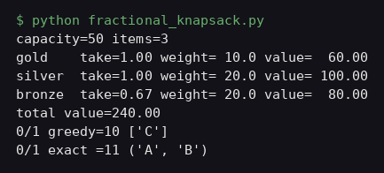
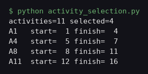
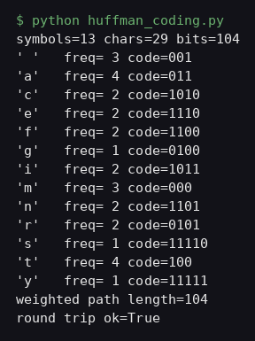
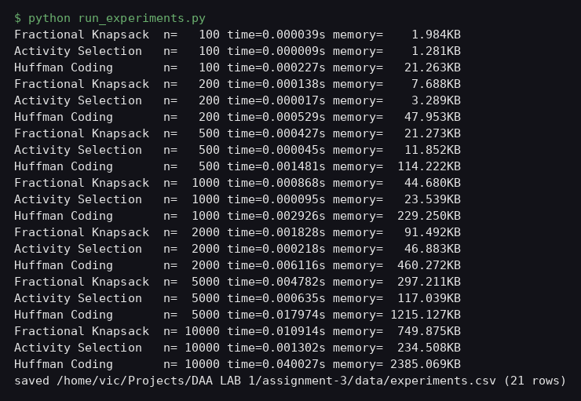
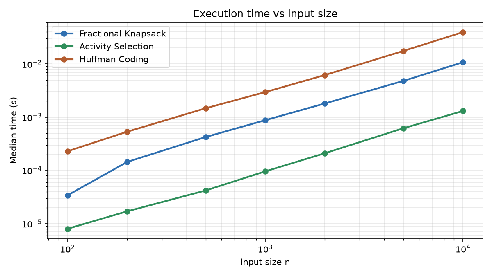
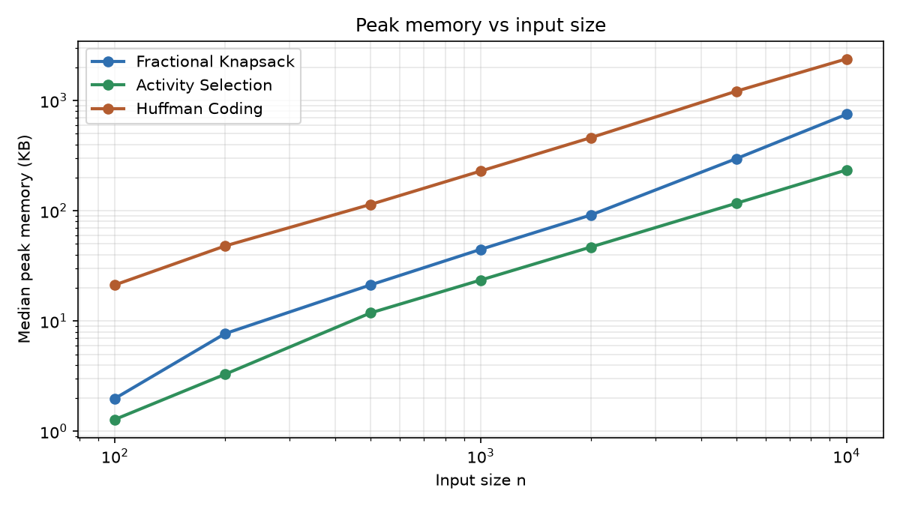
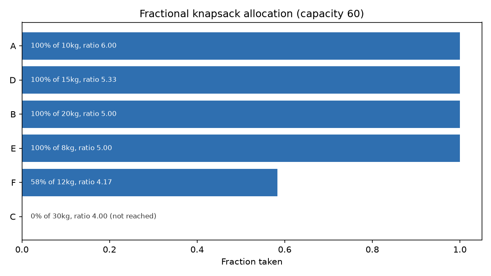
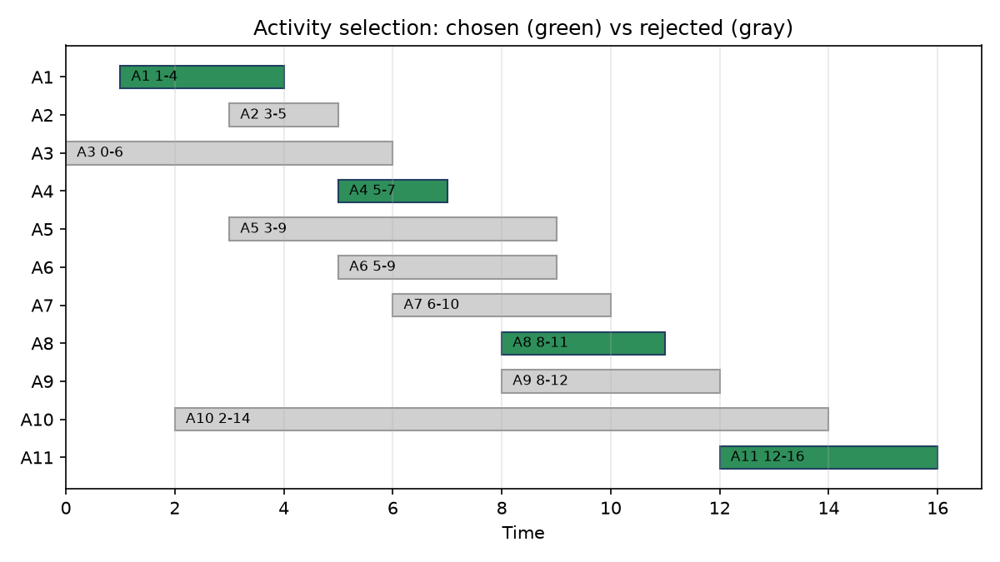
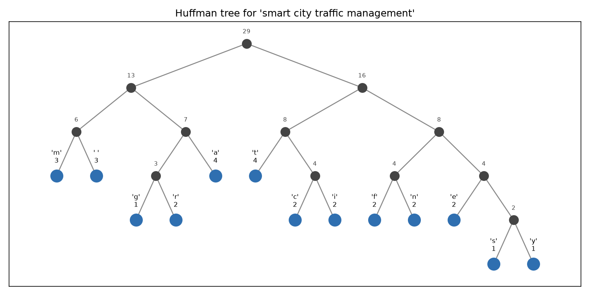

<div style="text-align: center;"></div>

<hr>

<div style="text-align: center;">
<h1>K.R. Mangalam University</h1>
<h3>School of Engineering and Technology</h3>
<h3>LAB 3: SMART RESOURCE ALLOCATION AND SCHEDULING SYSTEM<br>USING GREEDY ALGORITHMS</h3>
<p>Program: BCA (AI & DS) - Section B<br>Course Code - ENCA351 (2026-27)</p>
<p>GitHub: <a href="https://github.com/Vic-41148/algorithm-efficiency-case-study-aditya-shibu-2401201047">https://github.com/Vic-41148/algorithm-efficiency-case-study-aditya-shibu-2401201047</a></p>
</div>

<table class="front">
<tr>
<td><strong>Submitted by:</strong><br>Name: Aditya Shibu<br>Roll Number: 2401201047<br>Course: BCA (AI & DS) - Section B</td>
<td style="text-align: right;"><strong>Submitted To:</strong><br>Dr. Aarti Sangwan<br>Faculty, SOET</td>
</tr>
</table>

<div style="page-break-before: always;"></div>

<style>pre { font-size: 10px; } table { font-size: 12.5px; break-inside: avoid; } th, td { padding: 5px 10px; } table.front, table.front td { border: none; }</style>

## 1. Introduction

A greedy algorithm builds a solution one decision at a time and never
revisits a decision. At each step it takes the locally best option, which is
correct only when the problem has the greedy-choice property and optimal
substructure. This lab applies that pattern to three problems, measures the
cost of each on growing inputs, and shows one case where the same pattern
gives the wrong answer.

| Problem | Greedy rule | Section |
|---|---|---|
| Fractional Knapsack | take items by value/weight ratio, split the last | 2.1 |
| Activity Selection | take the activity that finishes first | 2.2 |
| Huffman Coding | merge the two least frequent symbols | 2.3 |

The submission has three parts:

1. Execution time, memory usage and a complexity comparison table for all
   three greedy algorithms (sections 2.4, 3.1 and 3.2).
2. Visualizations: resource allocation chart, activity timeline, Huffman
   tree and performance graphs (sections 3.3 to 3.6).
3. The complete report with name, roll number, specialisation, section, the
   tasks above, code, screenshots and the GitHub link (this document).

Objectives:

1. Implement the three greedy algorithms with clear inputs and outputs.
2. Prove, or at least argue, why each greedy choice is safe.
3. Measure execution time and peak memory across input sizes.
4. Compare measured growth with the theoretical bounds.
5. Show the 0/1 knapsack counterexample where greedy is suboptimal.

The workspace is one flat folder: `fractional_knapsack.py`,
`activity_selection.py` and `huffman_coding.py` hold one algorithm each;
`run_experiments.py` writes `data/experiments.csv`; `make_plots.py` reads
that CSV and writes the figures to `graphs/`. Terminal evidence is stored in
`screenshots/`, and `requirements.txt` lists the plotting package.

<div style="page-break-before: always;"></div>

## 2. Modules

### 2.1 Fractional Knapsack

Each item has a value and a weight. The bag has a capacity, and any item can
be split, so the algorithm may take a fraction of the last item that fits.
The greedy rule sorts items by value per unit weight, takes whole items while
they fit, then takes the fraction that fills the bag.

The rule is safe by an exchange argument. If an optimal solution uses a unit
of a lower-ratio item while a higher-ratio item is not exhausted, swap those
units. The total weight is unchanged and the total value cannot fall, so some
optimal solution also starts with the highest ratio. Repeating the swap gives
the greedy solution.

Sorting dominates: O(n log n) time. The take pass is O(n), and the ranked
list plus the pick list are O(n) space.



```python
"""Fractional Knapsack: greedy by value/weight ratio, the last item may split.

Items are (name, value, weight) tuples. Sorting by ratio costs O(n log n);
the take pass is O(n), so the algorithm is O(n log n) time and O(n) space.
"""
import random


def fractional_knapsack(items, capacity):
    """Fill the bag by descending value/weight ratio.

    Returns (total_value, picks). picks holds
    (name, fraction, weight_taken, value_taken) in take order.
    """
    ranked = sorted(items, key=lambda item: item[1] / item[2], reverse=True)
    total_value = 0.0
    remaining = float(capacity)
    picks = []
    for name, value, weight in ranked:
        if remaining <= 0:
            break
        fraction = min(1.0, remaining / weight)
        used = weight * fraction
        gained = value * fraction
        picks.append((name, fraction, used, gained))
        total_value += gained
        remaining -= used
    return total_value, picks


def greedy_01(items, capacity):
    """Apply the same ratio rule to 0/1 knapsack: whole items only.

    Kept to show the failure case. It can miss the optimum because it never
    revisits an early choice.
    """
    ranked = sorted(items, key=lambda item: item[1] / item[2], reverse=True)
    total_value = 0
    remaining = capacity
    taken = []
    for name, value, weight in ranked:
        if weight <= remaining:
            taken.append(name)
            total_value += value
            remaining -= weight
    return total_value, taken


def knapsack_01_exact(items, capacity):
    """Exhaustive 0/1 optimum for small n. Returns (best_value, subset)."""
    best_value = 0
    best_subset = ()
    count = len(items)
    for mask in range(1 << count):
        weight = value = 0
        subset = []
        for i in range(count):
            if mask & (1 << i):
                subset.append(items[i][0])
                value += items[i][1]
                weight += items[i][2]
        if weight <= capacity and value > best_value:
            best_value = value
            best_subset = tuple(subset)
    return best_value, best_subset


def make_items(n, seed=7):
    """Random items with value and weight in 1..100."""
    rng = random.Random(seed)
    return [(f"item{i:05d}", rng.randint(1, 100), rng.randint(1, 100))
            for i in range(n)]


if __name__ == "__main__":
    sample = [("gold", 60, 10), ("silver", 100, 20), ("bronze", 120, 30)]
    capacity = 50
    value, picks = fractional_knapsack(sample, capacity)
    print(f"capacity={capacity} items={len(sample)}")
    for name, fraction, used, gained in picks:
        print(f"{name:7s} take={fraction:4.2f} weight={used:5.1f} value={gained:7.2f}")
    print(f"total value={value:.2f}")

    counterexample = [("C", 10, 6), ("A", 6, 5), ("B", 5, 5)]
    bag = 10
    greedy_value, greedy_items = greedy_01(counterexample, bag)
    exact_value, exact_items = knapsack_01_exact(counterexample, bag)
    print(f"0/1 greedy={greedy_value} {greedy_items}")
    print(f"0/1 exact ={exact_value} {exact_items}")
```

<div style="page-break-before: always;"></div>

### 2.2 Activity Selection

Each activity has a start and a finish. Two activities are compatible when
one starts at or after the other finishes. The goal is the largest set of
compatible activities. The greedy rule sorts by finish time and keeps every
activity that starts after the last kept one finishes.

Choosing the earliest finish leaves the largest remaining interval for the
rest of the schedule. Any optimal solution can replace its first activity
with the earliest-finishing one without losing compatibility, so the greedy
choice is safe.

Sorting costs O(n log n); the selection pass is O(n). The selected list and
the sorted copy are O(n) space.



```python
"""Activity Selection: keep the largest set of non-overlapping activities.

Activities are (name, start, finish) tuples. Sorting by finish time costs
O(n log n); the selection pass is O(n), so O(n log n) time and O(n) space.
"""
import random


def activity_selection(activities):
    """Pick every activity that starts after the last chosen one finishes.

    Returns the selected (name, start, finish) tuples in finish order.
    """
    ranked = sorted(activities, key=lambda act: act[2])
    selected = []
    last_finish = float("-inf")
    for activity in ranked:
        name, start, finish = activity
        if start >= last_finish:
            selected.append(activity)
            last_finish = finish
    return selected


def make_activities(n, horizon=10000, seed=11):
    """Random activities with start in 0..horizon and length in 1..100."""
    rng = random.Random(seed)
    activities = []
    for i in range(n):
        start = rng.randint(0, horizon)
        finish = start + rng.randint(1, 100)
        activities.append((f"act{i:05d}", start, finish))
    return activities


if __name__ == "__main__":
    sample = [
        ("A1", 1, 4),
        ("A2", 3, 5),
        ("A3", 0, 6),
        ("A4", 5, 7),
        ("A5", 3, 9),
        ("A6", 5, 9),
        ("A7", 6, 10),
        ("A8", 8, 11),
        ("A9", 8, 12),
        ("A10", 2, 14),
        ("A11", 12, 16),
    ]
    chosen = activity_selection(sample)
    print(f"activities={len(sample)} selected={len(chosen)}")
    for name, start, finish in chosen:
        print(f"{name:4s} start={start:3d} finish={finish:3d}")
```

<div style="page-break-before: always;"></div>

### 2.3 Huffman Coding

Huffman coding gives frequent symbols short bit strings and rare symbols long
ones. A min-heap holds one tree per symbol, keyed by frequency. Each step
merges the two lightest trees into a parent whose weight is their sum. After
n-1 merges one tree remains, and the path from root to leaf gives the code
(left is 0, right is 1). No code is a prefix of another, so decoding is
unambiguous.

The two least frequent symbols can always be placed as siblings at the
deepest level of an optimal tree, which is the exchange argument behind the
merge rule. There are n-1 merges and each heap operation is O(log n), so the
run is O(n log n) time. The tree and the heap hold O(n) nodes.



```python
"""Huffman Coding: build an optimal prefix code from symbol frequencies.

A min-heap merges the two lightest trees until one root remains, which is
O(n log n) time and O(n) space for n symbols.
"""
import heapq
import random
from collections import Counter


class Node:
    """Leaf holds a symbol; internal nodes hold children and a summed weight."""

    __slots__ = ("weight", "symbol", "left", "right")

    def __init__(self, weight, symbol=None, left=None, right=None):
        self.weight = weight
        self.symbol = symbol
        self.left = left
        self.right = right

    def is_leaf(self):
        return self.symbol is not None


def build_tree(frequencies):
    """Merge the lightest two trees until one remains. Returns the root."""
    heap = []
    for serial, (symbol, weight) in enumerate(frequencies.items()):
        heapq.heappush(heap, (weight, serial, Node(weight, symbol)))
    if not heap:
        return None
    serial = len(heap)
    while len(heap) > 1:
        weight_a, _, left = heapq.heappop(heap)
        weight_b, _, right = heapq.heappop(heap)
        heapq.heappush(heap, (weight_a + weight_b, serial,
                              Node(weight_a + weight_b, None, left, right)))
        serial += 1
    return heap[0][2]


def build_codes(root):
    """Walk the tree and return {symbol: bit string}."""
    codes = {}
    stack = [(root, "")]
    while stack:
        node, prefix = stack.pop()
        if node.is_leaf():
            codes[node.symbol] = prefix or "0"
        else:
            stack.append((node.left, prefix + "0"))
            stack.append((node.right, prefix + "1"))
    return codes


def encode(text, codes):
    """Replace every character with its code."""
    return "".join(codes[character] for character in text)


def decode(bits, root):
    """Walk the tree for every bit and emit a symbol at each leaf."""
    if root.is_leaf():
        return root.symbol * len(bits)
    output = []
    node = root
    for bit in bits:
        node = node.left if bit == "0" else node.right
        if node.is_leaf():
            output.append(node.symbol)
            node = root
    return "".join(output)


def weighted_path_length(codes, frequencies):
    """Total encoded bits, the quantity Huffman minimises."""
    return sum(len(codes[symbol]) * weight
               for symbol, weight in frequencies.items())


def make_frequencies(n, seed=13):
    """Random frequencies in 1..1000 for n synthetic symbols."""
    rng = random.Random(seed)
    return {f"s{i:05d}": rng.randint(1, 1000) for i in range(n)}


if __name__ == "__main__":
    text = "smart city traffic management"
    frequencies = Counter(text)
    root = build_tree(frequencies)
    codes = build_codes(root)
    encoded = encode(text, codes)
    rebuilt = decode(encoded, root)
    print(f"symbols={len(codes)} chars={len(text)} bits={len(encoded)}")
    for symbol in sorted(codes):
        print(f"{symbol!r:5s} freq={frequencies[symbol]:2d} code={codes[symbol]}")
    print(f"weighted path length={weighted_path_length(codes, frequencies)}")
    print(f"round trip ok={rebuilt == text}")
```

<div style="page-break-before: always;"></div>

### 2.4 Complexity comparison

| Algorithm | Time | Space | Dominant cost |
|---|---|---|---|
| Fractional Knapsack | O(n log n) | O(n) | sort by ratio |
| Activity Selection | O(n log n) | O(n) | sort by finish |
| Huffman Coding | O(n log n) | O(n) | heap merges |

All three sit at O(n log n) because each spends most of its time ordering
data: two sort a list, and one repeatedly pulls the minimum from a heap. The
greedy pass after the ordering is linear, so it does not change the bound.

- **Fractional Knapsack.** The ratio sort needs Omega(n log n) comparisons in
  the worst case, and no comparison sort can do better. The take pass visits
  each item once and adds O(n). The ranked copy and the pick list hold n
  items, which gives O(n) space. If the items arrive already sorted by ratio,
  the algorithm drops to O(n).
- **Activity Selection.** Sorting by finish time is the only superlinear
  step, so the bound is O(n log n) and the memory is O(n). A pre-sorted input
  makes the run O(n). A dynamic program over start and finish times would
  cost O(n^2) or more, so the greedy order is what keeps this problem cheap.
- **Huffman Coding.** Each of the n-1 merges pushes and pops a heap of at
  most n trees, so the run is O(n log n), and the tree plus heap hold 2n-1
  nodes, which is O(n) space. The bound covers the total cost, not a single
  code: one symbol can still receive a code of length n-1 when the
  frequencies are extremely skewed.

The shared bound hides constant factors. At n=10000 the measured times were
0.0109 s, 0.0013 s and 0.0400 s, so Huffman is about 31 times slower than
activity selection even though both are O(n log n). Huffman pays for two heap
operations per merge and for allocating a node object at every step;
activity selection only compares one number per item.

The lower bound matters too. When the algorithm must order n items using
comparisons, Omega(n log n) is the floor, so none of these can be improved
without changing the model, for example by using integer keys and a linear
sort.

<div style="page-break-before: always;"></div>

## 3. Experiments

Runs use Python 3.14 on Linux. Time comes from `time.perf_counter` and memory
from `tracemalloc` peak. Each point is the median of five runs. Inputs are
generated before timing, with fixed seeds, so only the algorithm is measured.
Sizes are 100, 200, 500, 1000, 2000, 5000 and 10000.



### 3.1 Execution time

| n | Fractional Knapsack (s) | Activity Selection (s) | Huffman Coding (s) |
|---|---|---|---|
| 100 | 0.000039 | 0.000009 | 0.000227 |
| 200 | 0.000138 | 0.000017 | 0.000529 |
| 500 | 0.000427 | 0.000045 | 0.001481 |
| 1000 | 0.000868 | 0.000095 | 0.002926 |
| 2000 | 0.001828 | 0.000218 | 0.006116 |
| 5000 | 0.004782 | 0.000635 | 0.017974 |
| 10000 | 0.010914 | 0.001302 | 0.040027 |

A tenfold increase in n multiplies time by about 13, close to the n log n
prediction of 13.3. Huffman is the slowest because every symbol becomes a
node object and every merge touches the heap. Activity selection is the
fastest because its loop is a single comparison per activity.

### 3.2 Peak memory

| n | Fractional Knapsack (KB) | Activity Selection (KB) | Huffman Coding (KB) |
|---|---|---|---|
| 100 | 1.98 | 1.28 | 21.26 |
| 200 | 7.69 | 3.29 | 47.95 |
| 500 | 21.27 | 11.85 | 114.22 |
| 1000 | 44.68 | 23.54 | 229.25 |
| 2000 | 91.49 | 46.88 | 460.27 |
| 5000 | 297.21 | 117.04 | 1215.13 |
| 10000 | 749.88 | 234.51 | 2385.07 |

Memory grows linearly for all three. Huffman uses about ten times the memory
of the others at the same n because each symbol, each merge parent and each
heap entry is a separate Python object. The knapsack figure includes the
sorted copy of the item list and the pick list.

<div style="page-break-before: always;"></div>

### 3.3 Scaling charts

The time chart is log-log, so a slope near one means near-linear growth with
the n log n factor folded in.





### 3.4 Knapsack allocation

Six items, capacity 60. The bars are sorted by ratio. A, D, B and E are taken
whole, F is split at 58 percent, and C is never reached because the bag is
full.



<div style="page-break-before: always;"></div>

### 3.5 Activity timeline

Eleven activities, four selected (green). The earliest finish rule skips long
activities even when they start early, because a short activity leaves more
room for the rest.



<div style="page-break-before: always;"></div>

### 3.6 Huffman tree

The sample text has 13 distinct symbols and 29 characters. The tree yields a
weighted path length of 104 bits, against 145 bits for a fixed 5-bit code over
the same alphabet, and decoding returns the original text.



<div style="page-break-before: always;"></div>

## 4. Discussion

### 4.1 Why the greedy choice is safe

| Algorithm | Greedy choice | Exchange argument |
|---|---|---|
| Fractional Knapsack | highest value/weight ratio first | swap a lower-ratio unit for a higher-ratio unit, value cannot fall |
| Activity Selection | earliest finish first | replace the first activity with the earliest finisher, later activities still fit |
| Huffman Coding | merge the two lightest trees | the two least frequent symbols can be siblings at maximum depth |

In each case the problem also has optimal substructure: after the greedy
choice, the remaining problem has the same form as the original.

### 4.2 Where greedy fails: 0/1 knapsack

In 0/1 knapsack an item is taken whole or not at all, so the leftover capacity
cannot be filled with a fraction. The ratio rule can then block a better
combination.

| Item | Value | Weight | Value/weight |
|---|---|---|---|
| C | 10 | 6 | 1.67 |
| A | 6 | 5 | 1.20 |
| B | 5 | 5 | 1.00 |

Capacity 10:

| Method | Items | Value |
|---|---|---|
| Greedy, whole items only | C | 10 |
| Exact 0/1 | A and B | 11 |
| Fractional greedy | C plus 4/5 of A | 14.8 |

The greedy run takes C because it has the best ratio, then has 4 units left
and cannot fit A or B. The exact search takes A and B for 11. When splitting
is allowed the same choice is optimal, because the leftover 4 units are
filled from A. The failure is caused by the integrality constraint, not by the
ratio rule itself.

### 4.3 Applications

- Fractional knapsack: divisible resources such as bandwidth, fuel, budget
  portions and raw material.
- Activity selection: meeting-room booking, fixed-window job scheduling and
  event planning.
- Huffman coding: ZIP and gzip compression, image and video containers, and
  any format that stores a prefix code table.

### 4.4 Measured versus theoretical growth

| Algorithm | Time factor, 1000 to 10000 | Memory factor, 1000 to 10000 |
|---|---|---|
| Fractional Knapsack | 12.6 | 16.8 |
| Activity Selection | 13.7 | 10.0 |
| Huffman Coding | 13.7 | 10.4 |

The expected time factor for n log n is 13.3, which all three match within
measurement noise. Memory should grow by 10 for a linear structure. The
knapsack value is higher because the sort allocates temporary tuples and the
allocator keeps freed blocks, so peak memory is not a clean linear signal at
this scale.

<div style="page-break-before: always;"></div>

## 5. Conclusion

The three greedy algorithms were implemented and measured. All run in
O(n log n) time and O(n) space, and the measured time grows by about 13 times
for every tenfold increase in input, which matches n log n. Fractional
knapsack and activity selection are optimal because a local exchange keeps an
optimal solution intact. Huffman coding is optimal because the two lightest
symbols can always be placed deepest in the tree. Greedy is not a general
answer: on 0/1 knapsack the same ratio rule returns 10 where the optimum is
11. The choice of strategy depends on the structure of the problem, not on
the fact that a greedy rule looks reasonable.

## 6. How to reproduce

Run from this folder with Python 3 and the packages in `requirements.txt`:

```bash
python fractional_knapsack.py
python activity_selection.py
python huffman_coding.py
python run_experiments.py
python make_plots.py
```

`run_experiments.py` rewrites `data/experiments.csv`; `make_plots.py` reads
that CSV and rewrites the five figures in `graphs/`. The report tables above
come from the same CSV.

Repository:
https://github.com/Vic-41148/algorithm-efficiency-case-study-aditya-shibu-2401201047
