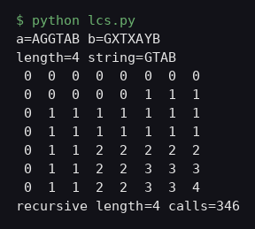
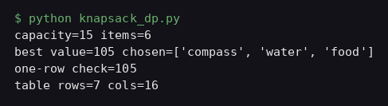
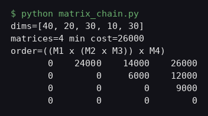
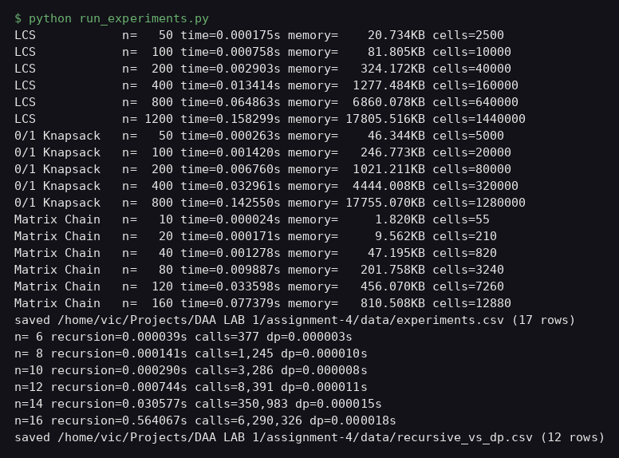
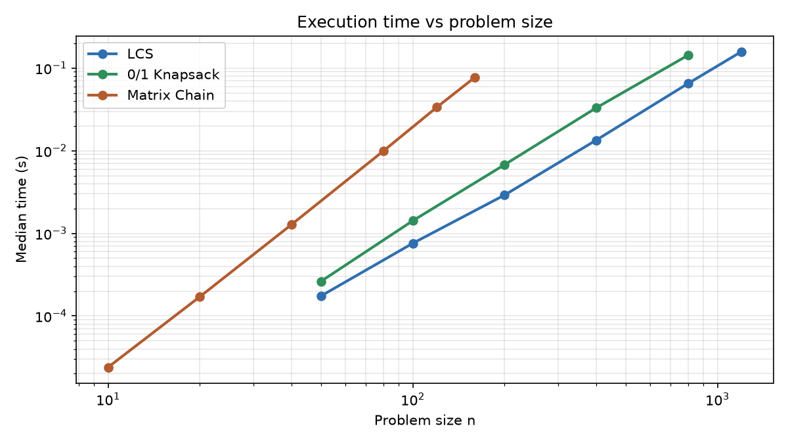
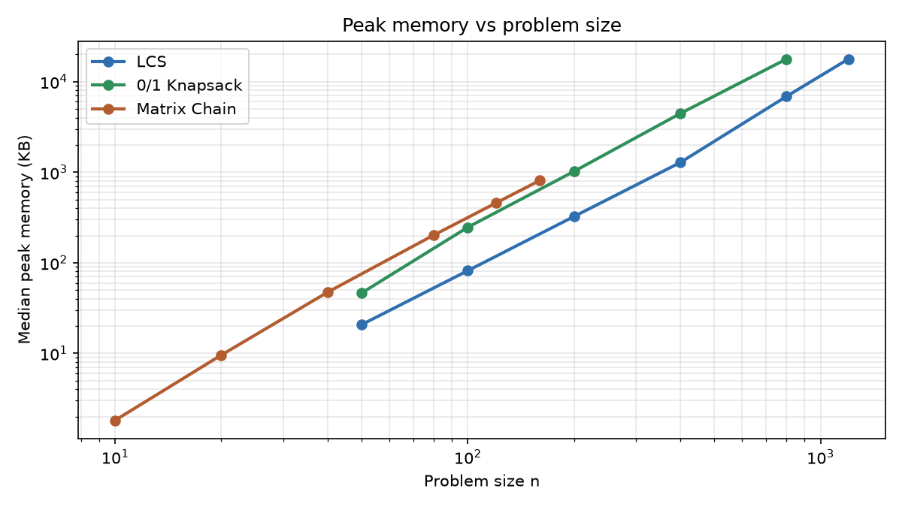
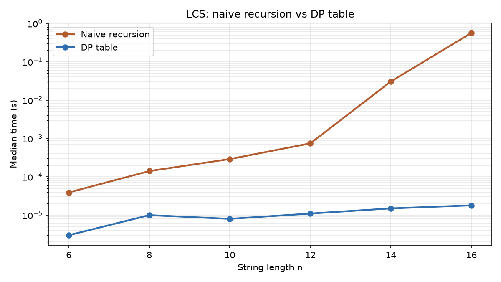
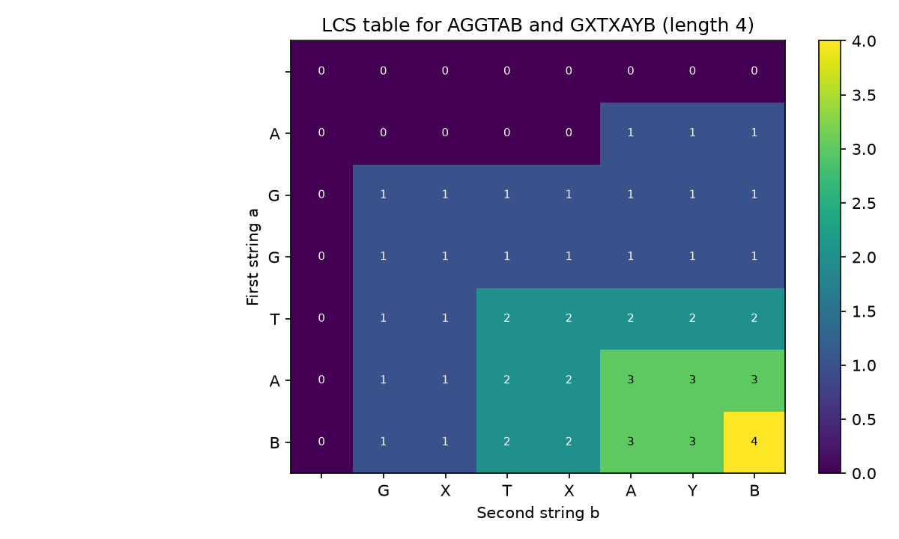
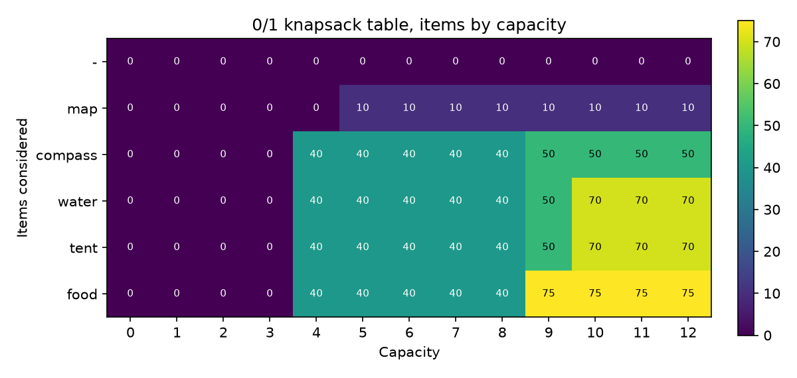
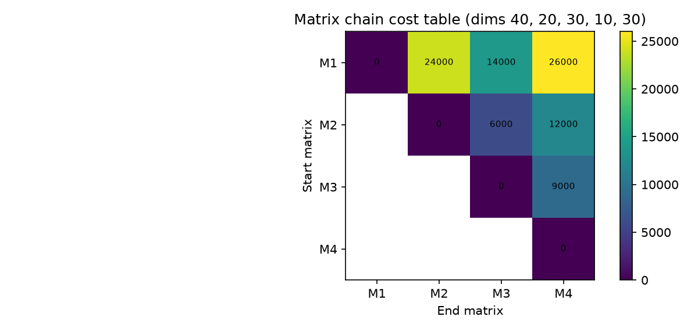

<div style="text-align: center;"></div>

<hr>

<div style="text-align: center;">
<h1>K.R. Mangalam University</h1>
<h3>School of Engineering and Technology</h3>
<h3>LAB 4 DYNAMIC PROGRAMMING REPORT</h3>
<p>Program: BCA (AI & DS) - Section B<br>Course Code - ENCA351 (2026-27)</p>
<p>GitHub: <a href="https://github.com/Vic-41148/algorithm-efficiency-case-study-aditya-shibu-2401201047">https://github.com/Vic-41148/algorithm-efficiency-case-study-aditya-shibu-2401201047</a></p>
</div>

<table class="front">
<tr>
<td><strong>Submitted by:</strong><br>Name: Aditya Shibu<br>Roll Number: 2401201047<br>Course: BCA (AI & DS) - Section B</td>
<td style="text-align: right;"><strong>Submitted To:</strong><br>Dr. Aarti Sangwan<br>Faculty, SOET</td>
</tr>
</table>

<div style="page-break-before: always;"></div>

<style>pre { font-size: 10px; } table { font-size: 12.5px; break-inside: avoid; } th, td { padding: 5px 10px; } table.front, table.front td { border: none; }</style>

## 1. Introduction

Dynamic programming solves a problem by combining answers to smaller
instances of the same problem. It applies when the problem has optimal
substructure, so an optimal answer contains optimal answers to subproblems,
and overlapping subproblems, so the same states are reached many times. A
table stores each state once, which turns repeated work into a lookup.

This lab applies the pattern to three problems, measures time, memory and
the number of states, and compares a naive recursion with the table version.

| Problem | State | Section |
|---|---|---|
| Longest Common Subsequence | table cell (i, j) for prefixes | 2.1 |
| 0/1 Knapsack | best value for first i items and capacity c | 2.2 |
| Matrix Chain Multiplication | cheapest cost for matrices i to j | 2.3 |

The submission has three parts:

1. Execution time, memory usage, subproblem counts and a complexity
   comparison table for all three dynamic programs (sections 2.4, 3.1 to
   3.3).
2. Visualizations: runtime and memory graphs, the recursive versus DP
   comparison, and the DP table heatmaps (sections 3.4 to 3.6).
3. The complete report with name, roll number, specialisation, section, the
   tasks above, code, screenshots and the GitHub link (this document).

Objectives:

1. Implement the three dynamic programs with table reconstruction.
2. State the recurrence and the number of distinct states for each.
3. Measure execution time and peak memory across sizes.
4. Draw the DP tables and the runtime curves.
5. Compare naive recursion with the table on the same LCS inputs.

The workspace is one flat folder: `lcs.py`, `knapsack_dp.py` and
`matrix_chain.py` hold one algorithm each; `run_experiments.py` writes
`data/experiments.csv` and `data/recursive_vs_dp.csv`; `make_plots.py`
writes the figures to `graphs/`. Terminal evidence is stored in
`screenshots/`, and `requirements.txt` lists the plotting package.

<div style="page-break-before: always;"></div>

## 2. Modules

### 2.1 Longest Common Subsequence

For prefixes a[0..i) and b[0..j), if the last characters match, the answer
is one plus the answer for both prefixes shortened by one. If they differ,
the answer is the better of dropping one character from either side. The
table is filled row by row because every cell uses only the cell above, the
cell to the left, and the diagonal.

Rebuilding the subsequence walks back from the bottom-right cell, taking a
character when the two current characters match and otherwise moving to the
larger neighbour. The table has (m+1)(n+1) states, so time and space are
O(mn) for strings of length m and n.

The recursive version keeps no table, so the same (i, j) pair is recomputed
along many paths. Its call count grows exponentially; the experiments below
measure that growth against the table.



```python
"""Longest Common Subsequence, bottom-up table plus naive recursion.

The DP table is (m+1) by (n+1). Each cell depends on the cell above, the
cell to the left, and the diagonal, so the run is O(mn) time and space.
The recursive version is kept to show the exponential cost without a table.
"""
import random


def lcs_table(a, b):
    """Return the (len(a)+1) by (len(b)+1) length table."""
    rows, cols = len(a) + 1, len(b) + 1
    table = [[0] * cols for _ in range(rows)]
    for i in range(1, rows):
        for j in range(1, cols):
            if a[i - 1] == b[j - 1]:
                table[i][j] = table[i - 1][j - 1] + 1
            else:
                table[i][j] = max(table[i - 1][j], table[i][j - 1])
    return table


def lcs_length(a, b):
    """Length of the longest common subsequence."""
    return lcs_table(a, b)[-1][-1]


def lcs_string(a, b):
    """Rebuild one longest common subsequence from the table."""
    table = lcs_table(a, b)
    i, j = len(a), len(b)
    output = []
    while i and j:
        if a[i - 1] == b[j - 1]:
            output.append(a[i - 1])
            i -= 1
            j -= 1
        elif table[i - 1][j] >= table[i][j - 1]:
            i -= 1
        else:
            j -= 1
    return "".join(reversed(output))


def lcs_recursive(a, b):
    """Naive recursion with no table. Returns (length, calls)."""
    calls = 0

    def walk(i, j):
        nonlocal calls
        calls += 1
        if i == 0 or j == 0:
            return 0
        if a[i - 1] == b[j - 1]:
            return 1 + walk(i - 1, j - 1)
        return max(walk(i - 1, j), walk(i, j - 1))

    return walk(len(a), len(b)), calls


def make_strings(n, seed=23, alphabet="ACGT"):
    """Two random strings of length n over the same alphabet."""
    rng = random.Random(seed)
    a = "".join(rng.choice(alphabet) for _ in range(n))
    b = "".join(rng.choice(alphabet) for _ in range(n))
    return a, b


if __name__ == "__main__":
    a, b = "AGGTAB", "GXTXAYB"
    table = lcs_table(a, b)
    print(f"a={a} b={b}")
    print(f"length={table[-1][-1]} string={lcs_string(a, b)}")
    for row in table:
        print(" ".join(f"{cell:2d}" for cell in row))
    length, calls = lcs_recursive(a, b)
    print(f"recursive length={length} calls={calls}")
```

### 2.2 0/1 Knapsack

Each item is taken whole or not at all. For the first i items and a capacity
c, the best value is either the value without item i, or the value with item
i plus the best value for the remaining capacity using the first i-1 items.
The second option is available only when the item fits.

The table is (n+1) by (C+1). Reconstructing the chosen set compares each row
with the row above: a difference marks a taken item, and the capacity drops
by that item's weight. Time and space are O(nC). The one-row variant scans
capacity backwards, which keeps each item from being reused and reduces space
to O(C).



```python
"""0/1 Knapsack, bottom-up table plus a one-row space optimisation.

Items are (name, value, weight) tuples. The table is (n+1) by (capacity+1),
so the run is O(n * capacity) time and space. The one-row version keeps
O(capacity) space by scanning the capacity backwards.
"""
import random


def knapsack_dp(items, capacity):
    """Return (best_value, table, chosen) for whole-item knapsack."""
    count = len(items)
    table = [[0] * (capacity + 1) for _ in range(count + 1)]
    for i in range(1, count + 1):
        _, value, weight = items[i - 1]
        for room in range(capacity + 1):
            table[i][room] = table[i - 1][room]
            if weight <= room:
                table[i][room] = max(table[i][room],
                                     table[i - 1][room - weight] + value)
    chosen = []
    room = capacity
    for i in range(count, 0, -1):
        if table[i][room] != table[i - 1][room]:
            name = items[i - 1][0]
            chosen.append(name)
            room -= items[i - 1][2]
    return table[count][capacity], table, list(reversed(chosen))


def knapsack_1d(items, capacity):
    """Same answer with one row of state. Returns the best value only."""
    best = [0] * (capacity + 1)
    for _, value, weight in items:
        for room in range(capacity, weight - 1, -1):
            if best[room - weight] + value > best[room]:
                best[room] = best[room - weight] + value
    return best[capacity]


def make_items(n, seed=29, max_value=100, max_weight=100):
    """Random items with value and weight in 1..max."""
    rng = random.Random(seed)
    return [(f"item{i:04d}", rng.randint(1, max_value),
             rng.randint(1, max_weight)) for i in range(n)]


if __name__ == "__main__":
    items = [("map", 10, 5), ("compass", 40, 4), ("water", 30, 6),
             ("tent", 50, 9), ("food", 35, 5), ("radio", 25, 3)]
    capacity = 15
    best, table, chosen = knapsack_dp(items, capacity)
    print(f"capacity={capacity} items={len(items)}")
    print(f"best value={best} chosen={chosen}")
    print(f"one-row check={knapsack_1d(items, capacity)}")
    print(f"table rows={len(table)} cols={len(table[0])}")
```

### 2.3 Matrix Chain Multiplication

Multiplying a chain of matrices does not change the result order, but the
number of scalar multiplications depends heavily on where the parentheses
go. For matrices i to j, the cost is the best split k of the cost of the left
part plus the cost of the right part plus the cost of joining the two results.
Intervals are processed by increasing length so both parts are ready before
the parent interval is computed.

The cost table is n by n and only the upper triangle is used, which is
n(n+1)/2 states. Each state tries every split, so time is O(n^3) and space is
O(n^2). The split table rebuilds the optimal parenthesization.



```python
"""Matrix Chain Multiplication, interval DP.

dims has n+1 entries for n matrices. The table is n by n and every entry
cost[i][j] is the cheapest cost to multiply matrices i..j. Each entry tries
every split point, so the run is O(n^3) time and O(n^2) space.
"""
import random


def matrix_chain(dims):
    """Return (min_cost, cost_table, split_table) for the given dimensions."""
    count = len(dims) - 1
    cost = [[0] * count for _ in range(count)]
    split = [[0] * count for _ in range(count)]
    for length in range(2, count + 1):
        for i in range(count - length + 1):
            j = i + length - 1
            cost[i][j] = float("inf")
            for k in range(i, j):
                candidate = (cost[i][k] + cost[k + 1][j]
                             + dims[i] * dims[k + 1] * dims[j + 1])
                if candidate < cost[i][j]:
                    cost[i][j] = candidate
                    split[i][j] = k
    return cost[0][count - 1], cost, split


def parenthesize(split, i, j):
    """Rebuild the optimal grouping from the split table."""
    if i == j:
        return f"M{i + 1}"
    k = split[i][j]
    return "(" + parenthesize(split, i, k) + " x " + parenthesize(split, k + 1, j) + ")"


def make_dims(n, seed=31, low=10, high=100):
    """n+1 random dimensions for n matrices."""
    rng = random.Random(seed)
    return [rng.randint(low, high) for _ in range(n + 1)]


if __name__ == "__main__":
    dims = [40, 20, 30, 10, 30]
    best, cost, split = matrix_chain(dims)
    print(f"dims={dims}")
    print(f"matrices={len(dims) - 1} min cost={best}")
    print(f"order={parenthesize(split, 0, len(dims) - 2)}")
    for row in cost:
        print(" ".join(f"{cell:8.0f}" for cell in row))
```

<div style="page-break-before: always;"></div>

### 2.4 Complexity comparison

| Problem | Time | Space | Distinct states |
|---|---|---|---|
| LCS | O(mn) | O(mn) | m n |
| 0/1 Knapsack | O(nC) | O(nC), O(C) with one row | n C |
| Matrix Chain | O(n^3) | O(n^2) | n(n+1)/2 |

The three bounds differ in what drives them. LCS depends on two string
lengths, knapsack on the item count and the numeric capacity, and matrix
chain on the number of matrices. That difference explains why the experiment
ranges are not the same for all three.

- **LCS.** Each of the (m+1)(n+1) cells does constant work, so time is O(mn);
  the table is the same size, so space is O(mn). Rebuilding the subsequence
  walks at most m+n cells, which is lower order. Keeping only the previous
  row reduces space to O(min(m,n)) when only the length is needed.
- **0/1 Knapsack.** The table has n(C+1) cells and each cell compares two
  values, so time and space are O(nC). This is called pseudopolynomial: C is
  a number, not the length of the input, so a large capacity with few items
  is still expensive. The experiments set C=2n, which turns the bound into
  O(n^2). The one-row variant keeps O(C) space but cannot rebuild the chosen
  set without extra work.
- **Matrix Chain.** There are n(n+1)/2 intervals and each tries up to n
  splits, so time is O(n^3); the cost and split tables are n by n, so space
  is O(n^2). Rebuilding the parentheses follows one split per interval.

Memory follows the table in every case, which is why the memory chart has the
same slopes as the time chart. The absolute sizes differ: at the largest
tested point LCS stores 1.44 million cells and peaks at 17.8 MB, knapsack
stores 1.28 million cells at 17.8 MB, and matrix chain stores 12,880 cost
cells at 0.81 MB. Matrix chain is the only one where time, not memory, is the
practical limit at these sizes.

The measured curves follow these exponents: doubling the matrix chain size
multiplies time by about 8, doubling the knapsack size by about 4, and a 1.5
times larger LCS input by about 2.4. Section 4.5 compares the factors with
the table.

## 3. Experiments

Runs use Python 3.14 on Linux. Time comes from `time.perf_counter` with
`tracemalloc` off, so the clock is not inflated by allocation tracking.
Memory comes from separate runs with `tracemalloc` on. Timing points are the
median of five runs, memory points the median of three. Inputs are generated
before timing with fixed seeds.

Sizes: LCS strings of length 50 to 1200, knapsack items 50 to 800 with
capacity 2n, matrix chains 10 to 160 matrices.



### 3.1 Longest Common Subsequence

| n | Time (s) | Peak memory (KB) | Subproblems |
|---|---|---|---|
| 50 | 0.000175 | 20.73 | 2,500 |
| 100 | 0.000758 | 81.81 | 10,000 |
| 200 | 0.002903 | 324.17 | 40,000 |
| 400 | 0.013414 | 1277.48 | 160,000 |
| 800 | 0.064863 | 6860.08 | 640,000 |
| 1200 | 0.158299 | 17805.52 | 1,440,000 |

Quadrupling n (400 to 800) multiplies time by 4.8 and memory by 5.4, close
to the quadratic prediction of 16. From 800 to 1200, a 1.5 times larger input,
time grows 2.4 times and memory 2.6 times, against 2.25 expected.

### 3.2 0/1 Knapsack

| n | Time (s) | Peak memory (KB) | Subproblems |
|---|---|---|---|
| 50 | 0.000263 | 46.34 | 5,000 |
| 100 | 0.001420 | 246.77 | 20,000 |
| 200 | 0.006760 | 1021.21 | 80,000 |
| 400 | 0.032961 | 4444.01 | 320,000 |
| 800 | 0.142550 | 17755.07 | 1,280,000 |

Capacity grows with n, so the work is quadratic in n. Doubling n from 400 to
800 multiplies time by 4.3 and memory by 4.0, which matches the n C bound.
The one-row variant uses O(C) memory but is not timed here because it solves
the same number of states.

### 3.3 Matrix Chain Multiplication

| n | Time (s) | Peak memory (KB) | Subproblems |
|---|---|---|---|
| 10 | 0.000024 | 1.82 | 55 |
| 20 | 0.000171 | 9.56 | 210 |
| 40 | 0.001278 | 47.20 | 820 |
| 80 | 0.009887 | 201.76 | 3,240 |
| 120 | 0.033598 | 456.07 | 7,260 |
| 160 | 0.077379 | 810.51 | 12,880 |

Doubling n from 80 to 160 multiplies time by 7.8, close to the cubic
prediction of 8, and memory by 4.0, which matches the quadratic table.

### 3.4 Scaling charts

The runtime chart is log-log. LCS and knapsack are close to a slope of two,
matrix chain is closer to three. Memory follows the same pattern because the
table size sets both.





### 3.5 Recursive versus DP

Same random strings, naive recursion against the table:

| n | Recursion time (s) | Recursion calls | DP time (s) | Speedup |
|---|---|---|---|---|
| 6 | 0.000039 | 377 | 0.000003 | 13x |
| 8 | 0.000141 | 1,245 | 0.000010 | 14x |
| 10 | 0.000290 | 3,286 | 0.000008 | 36x |
| 12 | 0.000744 | 8,391 | 0.000011 | 68x |
| 14 | 0.030577 | 350,983 | 0.000015 | 2038x |
| 16 | 0.564067 | 6,290,326 | 0.000018 | 31,337x |

At n=16 the recursion makes 6.29 million calls while the table fills 256
cells. The speedup grows with n because the number of repeated states grows
faster than the table.



### 3.6 DP table heatmaps

The LCS table for AGGTAB and GXTXAYB has length 4. The highlighted diagonal
steps are the matches that build the subsequence GTAB.



The knapsack table shows the best value for each item prefix and capacity.
The value rises in steps as items start to fit.



The matrix chain table for dimensions 40, 20, 30, 10, 30 gives a minimum of
26000 with the order ((M1 x (M2 x M3)) x M4). Only the upper triangle is
filled.



<div style="page-break-before: always;"></div>

## 4. Discussion

### 4.1 Optimal substructure

| Problem | Optimal answer uses | Why it is safe |
|---|---|---|
| LCS | optimal answers for shorter prefixes | a match extends an optimal prefix answer, a mismatch keeps the better of two optimal prefix answers |
| 0/1 Knapsack | optimal answers for fewer items and less capacity | the last item is either excluded or added to an optimal solution of the smaller capacity |
| Matrix Chain | optimal costs for the two split parts | the cheapest full grouping must use the cheapest grouping inside each part |

### 4.2 Overlapping subproblems

The recursion tree for LCS reaches the same (i, j) pair through many orders
of deletions. The table keeps one value per pair, so each state is computed
once. The measured call count shows the effect: 6.29 million calls at n=16
against 256 states. Knapsack and matrix chain have the same property, which
is why their tables are smaller than their recursion trees.

<div style="page-break-before: always;"></div>

### 4.3 Recursive versus DP

The naive recursion is simple and correct but exponential, because it pays
again for every repeated state. The table version trades memory for time: it
stores every state, but each state is solved once. Memoization gives the same
time with recursion plus a cache, at the cost of call overhead. The table
wins for dense state spaces, where almost every state is reached.

Memory is the price. LCS at n=1200 stores 1.44 million cells and peaks at
17.8 MB. The one-row knapsack variant shows that the space bound can often be
reduced when only the final value is needed; LCS can be reduced to two rows
the same way.

### 4.4 Applications

- LCS: diff tools, DNA and protein alignment, plagiarism detection and
  version comparison.
- 0/1 Knapsack: budget selection, cargo loading, project portfolios and
  resource planning with indivisible items.
- Matrix Chain: query plan optimisation in databases, graphics transform
  pipelines and compiler expression ordering.

### 4.5 Measured versus theoretical growth

| Case | Observed factor | Expected factor |
|---|---|---|
| LCS time, 800 to 1200 | 2.44 | 2.25 (quadratic) |
| LCS memory, 800 to 1200 | 2.60 | 2.25 (quadratic) |
| Knapsack time, 400 to 800 | 4.33 | 4.00 (quadratic) |
| Knapsack memory, 400 to 800 | 4.00 | 4.00 (quadratic) |
| Matrix chain time, 80 to 160 | 7.83 | 8.00 (cubic) |
| Matrix chain memory, 80 to 160 | 4.02 | 4.00 (quadratic) |

The table sizes follow the bounds closely. Time is slightly above the bound
at the large LCS sizes, where the table no longer fits in cache and memory
access dominates the inner loop.

<div style="page-break-before: always;"></div>

## 5. Conclusion

Three dynamic programs were implemented, measured and drawn. LCS runs in
O(mn), knapsack in O(nC) and matrix chain in O(n^3), and the measured growth
matches those bounds for time, memory and state count. The table turns an
exponential recursion into a polynomial one: at n=16 the naive LCS makes
6.29 million calls while the table fills 256 cells, a speedup above 31,000
times. The cost is memory, which grows with the number of states unless a
reduced-space variant is used. Dynamic programming is therefore the right
tool when subproblems repeat and the state space is small enough to store.

## 6. How to reproduce

Run from this folder with Python 3 and the packages in `requirements.txt`:

```bash
python lcs.py
python knapsack_dp.py
python matrix_chain.py
python run_experiments.py
python make_plots.py
```

`run_experiments.py` rewrites `data/experiments.csv` and
`data/recursive_vs_dp.csv`; `make_plots.py` reads both and rewrites the six
figures in `graphs/`. The report tables come from the same CSV files.

Repository:
https://github.com/Vic-41148/algorithm-efficiency-case-study-aditya-shibu-2401201047
