<div style="text-align: center;"></div>

<hr>

<div style="text-align: center;">
<h1>K.R. Mangalam University</h1>
<h3>School of Engineering and Technology</h3>
<h3>SMART CITY TRAFFIC MANAGEMENT AND ROUTE OPTIMIZATION SYSTEM</h3>
<p>Program: BCA (AI & DS)<br>Course Code - ENCA351 (2026-27)</p>
<p>GitHub: <a href="https://github.com/Vic-41148/algorithm-efficiency-case-study-aditya-shibu-2401201047">algorithm-efficiency-case-study-aditya-shibu-2401201047</a></p>
</div>

<table class="front">
<tr>
<td><strong>Submitted by:</strong><br>Name: Aditya Shibu<br>Roll Number: 2401201047<br>Course: BCA (AI & DS) - Section B</td>
<td style="text-align: right;"><strong>Submitted To:</strong><br>Dr. Aarti Sangwan<br>Faculty, SOET</td>
</tr>
</table>

<style>pre { font-size: 10px; } table { font-size: 12.5px; break-inside: avoid; } th, td { padding: 5px 10px; } table.front, table.front td { border: none; } img[src*="screenshots/app_"] { max-height: 380px; }</style>

<div style="page-break-before: always;"></div>

## 1. Introduction

Smart city initiatives use intelligent algorithms to run transportation:
road networks are modeled as graphs, shortest-path algorithms route
commuters, traversal maps reachable zones, and spanning trees plan the
cheapest infrastructure that keeps every intersection connected.

Traffic optimization matters because congestion wastes time and fuel,
delays emergency response, and underuses existing roads. A system that
recomputes routes when roads jam, and that plans new links for minimum
cost, turns the road network from a static map into a managed resource.

This project builds such a system: a 10-intersection sample city plus
four modules (route planning with Dijkstra, congestion analysis with
Bellman-Ford, BFS/DFS connectivity, Prim/Kruskal MST), scaling runs on
10 to 200 intersections, 10 unit tests, and an interactive Streamlit app.

Work is delivered against the five capstone phases:

| Phase | Deliverable | Where |
|---|---|---|
| 1 | Project setup and road network modeling | 2.1, repository layout |
| 2 | Route planning and traffic analysis | 2.2, 2.3, 4.2 |
| 3 | Network connectivity analysis | 2.4 |
| 4 | Infrastructure planning and comparison | 2.5, 2.6, 4.3 |
| 5 | Interface, visualization, testing, report | 3, 4, 5, 6 |

<div style="page-break-before: always;"></div>

## 2. Modules

### 2.1 Road network modeling

Intersections are vertices, roads are weighted undirected edges (travel
cost). The model exposes both representations:

route_planner.py (RoadNetwork model):

```python
class RoadNetwork:
    """Undirected weighted graph. Nodes = intersections, edges = roads."""

    def __init__(self):
        self.adj = {}   # node -> {neighbor: weight}

    def add_intersection(self, name):
        self.adj.setdefault(name, {})

    def add_road(self, u, v, w, two_way=True):
        self.add_intersection(u)
        self.add_intersection(v)
        self.adj[u][v] = w
        if two_way:
            self.adj[v][u] = w

    def nodes(self):
        return sorted(self.adj)

    def roads(self):
        seen, out = set(), []
        for u, nbrs in self.adj.items():
            for v, w in nbrs.items():
                if (v, u) not in seen:
                    seen.add((u, v))
                    out.append((u, v, w))
        return sorted(out)

    def adjacency_list(self):
        return {u: sorted(nbrs.items()) for u, nbrs in sorted(self.adj.items())}

    def adjacency_matrix(self):
        nodes = self.nodes()
        idx = {n: i for i, n in enumerate(nodes)}
        n = len(nodes)
        mat = [[0] * n for _ in range(n)]
        for u, v, w in self.roads():
            mat[idx[u]][idx[v]] = w
            mat[idx[v]][idx[u]] = w
        return nodes, mat
```

Roads can also come from a CSV file. `sample_roads.csv` stores the same
14 roads with `from,to,weight` columns, and `load_network` accepts a path
or an open text stream:

route_planner.py (CSV loader):

```python
def load_network(source):
    """Build a network from CSV rows with from, to and weight columns."""
    if hasattr(source, "read"):
        return _load_rows(source)
    with open(source, newline="") as handle:
        return _load_rows(handle)


def _load_rows(handle):
    network = RoadNetwork()
    for row in csv.DictReader(handle):
        network.add_road(row["from"].strip(), row["to"].strip(),
                         int(row["weight"]))
    return network
```

```text
from,to,weight
Library,Station,4
Library,Park,3
Station,Hospital,5
```

14 rows in total. The loader is also what the sidebar uploader in the app
passes, so terminal runs and uploaded networks share one path.

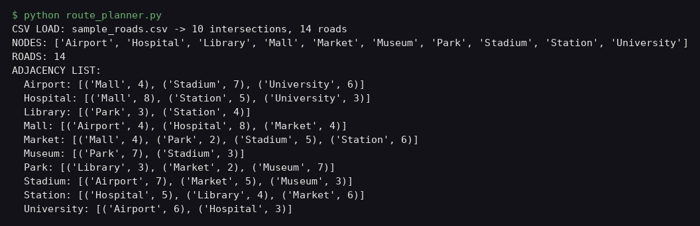

The matrix uses 0 for "no road". With 10 intersections it holds 100
cells, while the adjacency list holds 2E = 28 directed entries for 14
undirected roads. The list is the better default for this sparse city;
the matrix is O(V^2) and only wins for dense graphs or constant-time edge
tests.

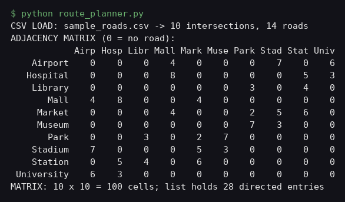


<div style="page-break-before: always;"></div>

### 2.2 Route planning (Dijkstra)

A commuter enters source and destination; the system settles intersections
in order of current-best distance and returns the shortest route, its cost,
and the settle trace.

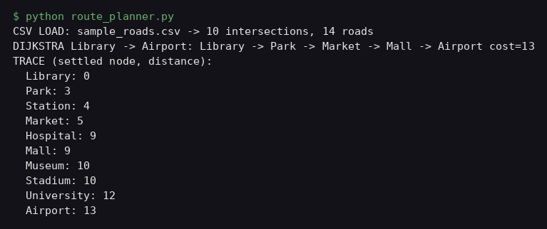

route_planner.py (Dijkstra):

```python
def dijkstra(network, source, dest):
    """Shortest path. Returns (path, cost, trace) where trace lists
    each settled node with its final distance, in settle order."""
    dist = {n: float("inf") for n in network.nodes()}
    prev = {}
    dist[source] = 0
    pq, visited, trace = [(0, source)], set(), []
    while pq:
        d, u = heapq.heappop(pq)
        if u in visited:
            continue
        visited.add(u)
        trace.append((u, d))
        if u == dest:
            break
        for v, w in network.adj[u].items():
            nd = d + w
            if nd < dist[v]:
                dist[v] = nd
                prev[v] = u
                heapq.heappush(pq, (nd, v))
    if dist[dest] == float("inf"):
        return [], float("inf"), trace
    path, cur = [], dest
    while cur != source:
        path.append(cur)
        cur = prev[cur]
    path.append(source)
    return path[::-1], dist[dest], trace
```

Library to Airport settles
Library(0), Park(3), Station(4), Market(5), Hospital(9), Mall(9),
Museum(10), Stadium(10), University(12), Airport(13) and returns
Library -> Park -> Market -> Mall -> Airport, cost 13 (3+2+4+4).

### 2.3 Traffic analysis (Bellman-Ford plus congestion)

Administrators scale selected road weights to simulate jams, then
recompute the route with Dijkstra. Bellman-Ford runs separately on the
original graph as an independent shortest-path check and reports
per-round relaxation counts plus negative-cycle status.

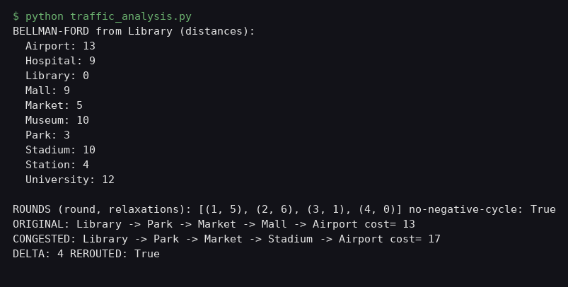

traffic_analysis.py (Bellman-Ford):

```python
def bellman_ford(network, source):
    """Shortest paths from source. Returns (dist, prev, trace, ok) where
    trace records every relaxation round and ok=False on negative cycle."""
    nodes = network.nodes()
    dist = {n: float("inf") for n in nodes}
    prev = {}
    dist[source] = 0
    trace = []
    for i in range(len(nodes) - 1):
        changed = 0
        for u, v, w in network.roads():
            for a, b in ((u, v), (v, u)):
                if dist[a] + w < dist[b]:
                    dist[b] = dist[a] + w
                    prev[b] = a
                    changed += 1
        trace.append((i + 1, changed))
        if changed == 0:
            break
    ok = True
    for u, v, w in network.roads():
        for a, b in ((u, v), (v, u)):
            if dist[a] + w < dist[b]:
                ok = False
    return dist, prev, trace, ok
```

Jamming Market-Mall and Mall-Airport by x3 moves the Airport route to
Library -> Park -> Market -> Stadium -> Airport, cost 13 -> 17
(delta +4, rerouted). Round trace: (1, 5), (2, 6), (3, 1), (4, 0).

The table runs four scenarios on the same trip. Two reroute, one raises
the cost without a better alternative, and one jams a road that is not on
the route:

| Jammed roads | Factor | Original route (cost) | Congested route (cost) | Delta | Rerouted? |
|---|---|---|---|---|---|
| Market-Mall + Mall-Airport | 3 | Library -> Park -> Market -> Mall -> Airport (13) | Library -> Park -> Market -> Stadium -> Airport (17) | +4 | yes |
| Library-Park | 3 | Library -> Park -> Market -> Mall -> Airport (13) | Library -> Station -> Hospital -> University -> Airport (18) | +5 | yes |
| Park-Market | 3 | Library -> Park -> Market -> Mall -> Airport (13) | unchanged (17) | +4 | no |
| Park-Museum | 3 | Library -> Park -> Market -> Mall -> Airport (13) | unchanged (13) | 0 | no |

All trips are Library to Airport. The last two rows show that the system
does not reroute for its own sake: Park-Market has no cheaper alternative,
and Park-Museum is off the route.

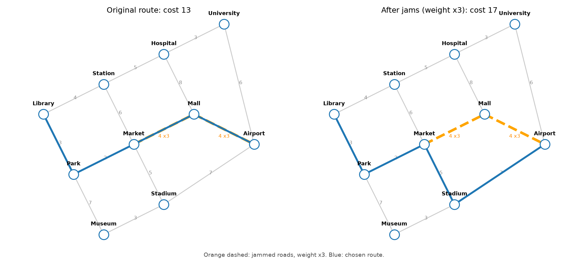

traffic_analysis.py (congestion compare):

```python
def apply_congestion(network, congested_edges, factor):
    """Copy of network with listed roads scaled by factor. Returns new network."""
    from route_planner import RoadNetwork
    busy = RoadNetwork()
    congested = {tuple(sorted(e)) for e in congested_edges}
    for u, v, w in network.roads():
        busy.add_road(u, v, w * factor if tuple(sorted((u, v))) in congested else w)
    return busy


def compare_routes(network, source, dest, congested_edges, factor):
    """Original vs congested shortest routes. Returns dict with both."""
    p0, c0, _ = dijkstra(network, source, dest)
    busy = apply_congestion(network, congested_edges, factor)
    p1, c1, _ = dijkstra(busy, source, dest)
    return {"original": (p0, c0), "congested": (p1, c1),
            "delta": c1 - c0, "rerouted": p0 != p1}
```

<div style="page-break-before: always;"></div>

### 2.4 Connectivity (BFS plus DFS)

From any start intersection the system lists traversal order and the
reachable set (10/10 on the sample city - one connected component). Both
traversals also record the edge that first discovers each node, so each
run yields a 9-edge tree for the 10-node city.

BFS from Library:
Library -> Park -> Station -> Market -> Museum -> Hospital -> Mall ->
Stadium -> University -> Airport.
DFS from Library:
Library -> Park -> Market -> Mall -> Airport -> Stadium -> Museum ->
University -> Hospital -> Station.


connectivity_module.py (tree-recording traversals):

```python
def bfs(network, start):
    """Breadth-first order from start. Returns (order, reachable, tree)."""
    order, seen, tree = [], {start}, []
    queue = deque([start])
    while queue:
        u = queue.popleft()
        order.append(u)
        for v in sorted(network.adj[u]):
            if v not in seen:
                seen.add(v)
                tree.append((u, v))
                queue.append(v)
    return order, seen, tree


def dfs(network, start):
    """Depth-first order from start. Returns (order, reachable, tree)."""
    order, seen, tree = [], set(), []
    stack = [(start, None)]
    while stack:
        u, parent = stack.pop()
        if u in seen:
            continue
        seen.add(u)
        order.append(u)
        if parent is not None:
            tree.append((parent, u))
        for v in sorted(network.adj[u], reverse=True):
            if v not in seen:
                stack.append((v, u))
    return order, seen, tree
```

Each tree edge is the road that first discovers the child. The visit
number is in brackets:

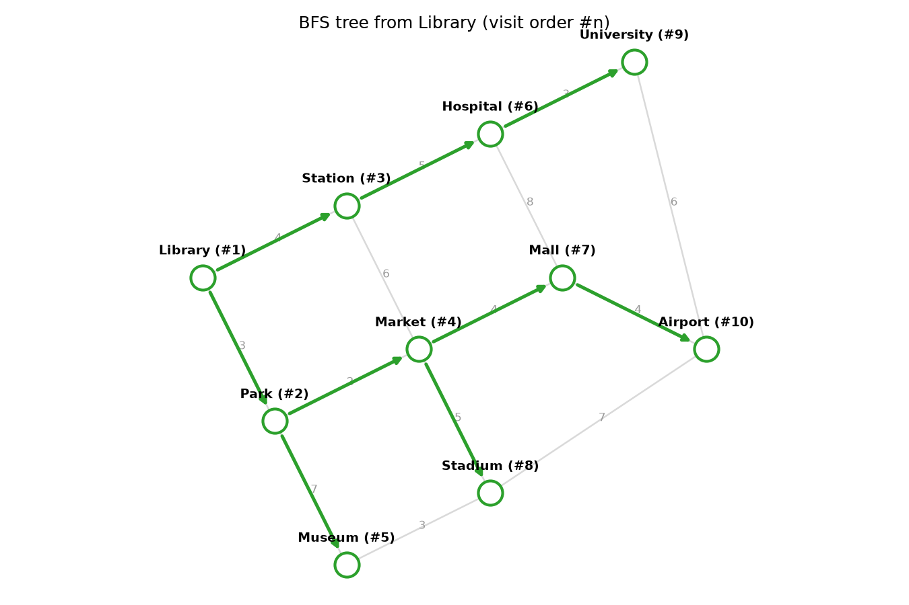

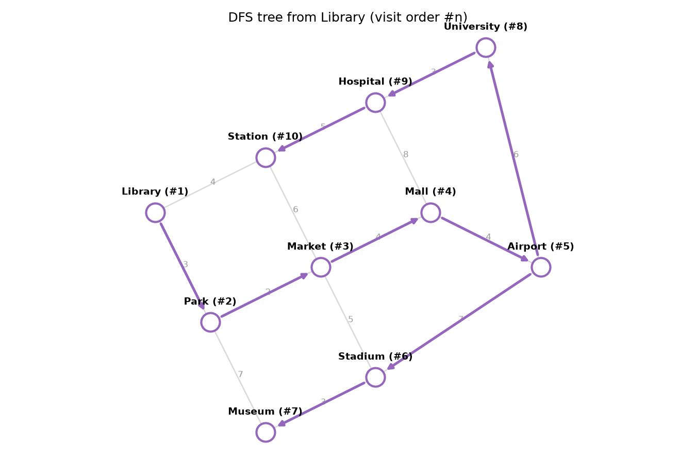

BFS visits level by level and reaches Airport in 4 hops. DFS runs
Library -> Park -> Market -> Mall -> Airport before backtracking to
Stadium and Museum. The grey roads are non-tree edges.

| Property | BFS | DFS |
|---|---|---|
| Frontier | queue (FIFO) | stack (LIFO) |
| Visit pattern | level by level | deep branch first |
| Tree shape | wide and short | narrow and deep |
| Airport path | 4 edges | 4 edges |
| Tree edges | 9 | 9 |

Both trees have V-1 edges because the sample city is connected; the
difference is shape, not edge count.

<div style="page-break-before: always;"></div>

### 2.5 Infrastructure planning (Prim plus Kruskal)

Both MST builders run on the same network and must agree; on the sample
city both select 9 roads totaling 33.

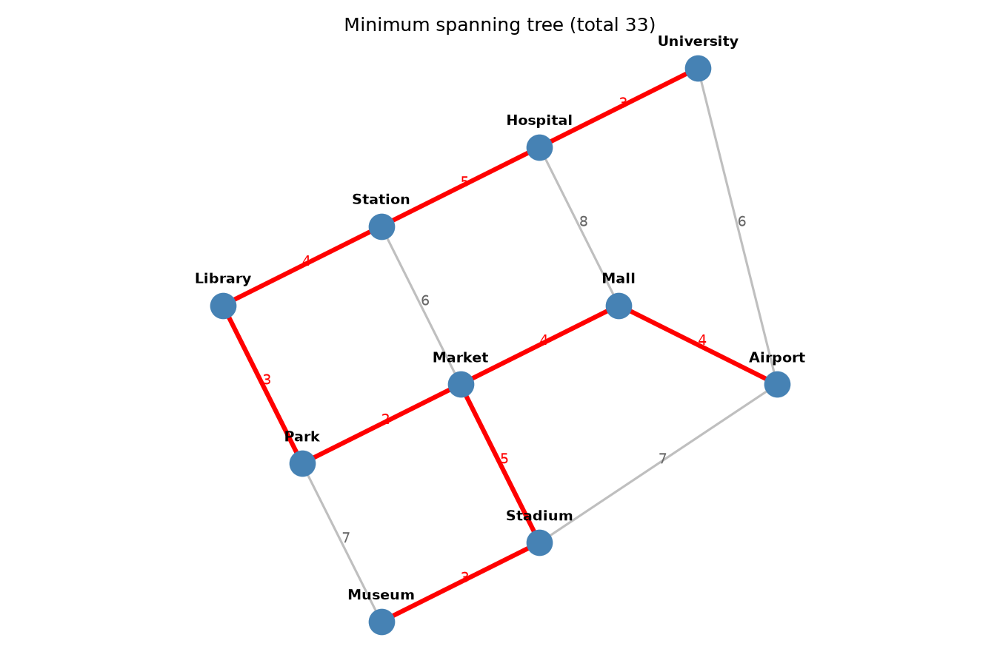

mst_planner.py (UnionFind plus builders):

```python
class UnionFind:
    def __init__(self, nodes):
        self.parent = {n: n for n in nodes}
        self.rank = {n: 0 for n in nodes}

    def find(self, x):
        while self.parent[x] != x:
            self.parent[x] = self.parent[self.parent[x]]
            x = self.parent[x]
        return x

    def union(self, a, b):
        ra, rb = self.find(a), self.find(b)
        if ra == rb:
            return False
        if self.rank[ra] < self.rank[rb]:
            ra, rb = rb, ra
        self.parent[rb] = ra
        if self.rank[ra] == self.rank[rb]:
            self.rank[ra] += 1
        return True
```

```python
def prim(network, start=None):
    """Grow MST from cheapest frontier edge. Returns (edges, total)."""
    import heapq
    nodes = network.nodes()
    start = start or nodes[0]
    visited, edges, total = {start}, [], 0
    pq = [(w, start, v) for v, w in network.adj[start].items()]
    heapq.heapify(pq)
    while pq and len(visited) < len(nodes):
        w, u, v = heapq.heappop(pq)
        if v in visited:
            continue
        visited.add(v)
        edges.append((u, v, w))
        total += w
        for to, w2 in network.adj[v].items():
            if to not in visited:
                heapq.heappush(pq, (w2, v, to))
    return sorted(edges), total


def kruskal(network):
    """Sort all roads, take cheapest that connects components."""
    uf = UnionFind(network.nodes())
    edges, total = [], 0
    for u, v, w in sorted(network.roads(), key=lambda e: e[2]):
        if uf.union(u, v):
            edges.append((u, v, w))
            total += w
    return sorted(edges), total
```

### 2.6 Complexity comparison

| Algorithm | Time | Space | Basis |
|---|---|---|---|
| Graph build (list) | O(V + E) | O(V + E) | one entry per road |
| Graph build (matrix) | O(V^2) | O(V^2) | every cell initialised |
| Dijkstra | O((V + E) log V) | O(V + E) | binary heap of frontier nodes |
| Bellman-Ford | O(V * E) | O(V) | V-1 sweeps over all roads |
| BFS | O(V + E) | O(V) | queue and visited set |
| DFS | O(V + E) | O(V) | stack and visited set |
| Prim | O(E log V) | O(V + E) | heap of frontier edges |
| Kruskal | O(E log E) | O(V + E) | sort dominates, union-find near constant |

The measured curves and observed exponents in section 4 track these
bounds: traversal sits near linear, Dijkstra and Prim near 1.1, and
Bellman-Ford widens fastest because each sweep touches every road, even
though its early exit stops well before V-1 rounds.

<div style="page-break-before: always;"></div>

## 3. Interactive application

app.py is a Streamlit front end over the same modules: four tabs, node
pickers, a congestion factor slider, and result tables. A sidebar uploader
accepts the same CSV format and replaces the sample city, so the numbers in
the interface match the terminal runs.

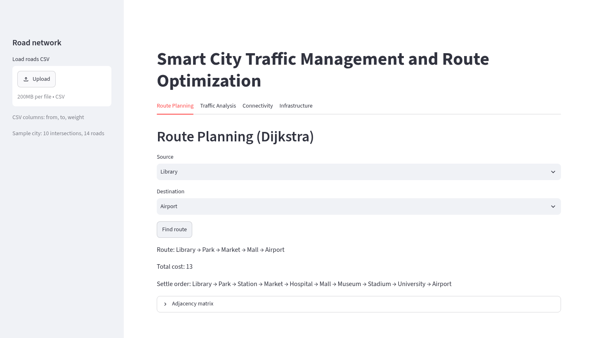

The route tab returns the path, cost, settle order, and an adjacency matrix
expander. The screenshot also shows the sidebar loader with the sample city
caption.

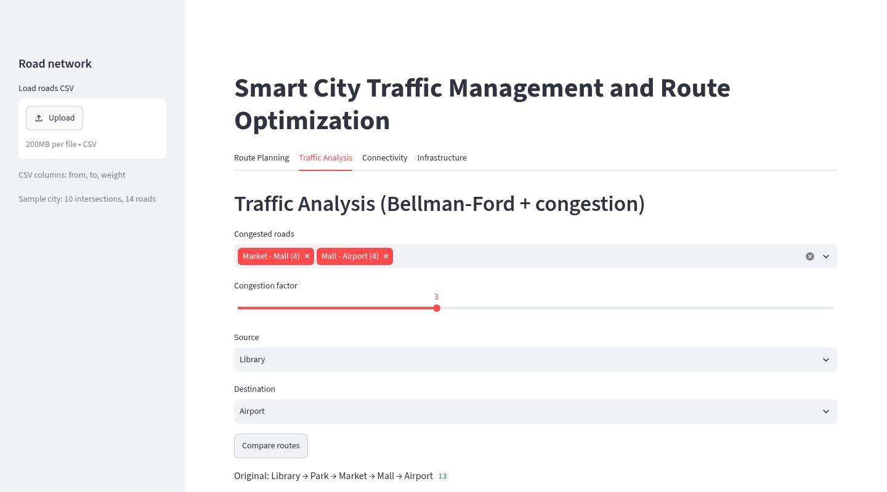

The traffic tab compares original and congested routes after jammed roads
are selected; the example moves the route from cost 13 to 17.

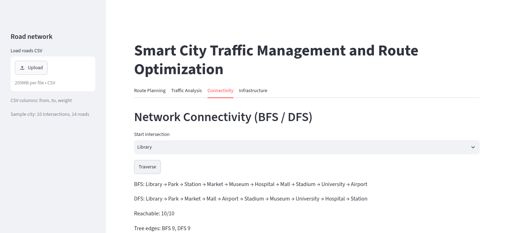

The connectivity tab lets the user pick the start intersection and prints
BFS and DFS orders, the reachable count, and both tree-edge counts.

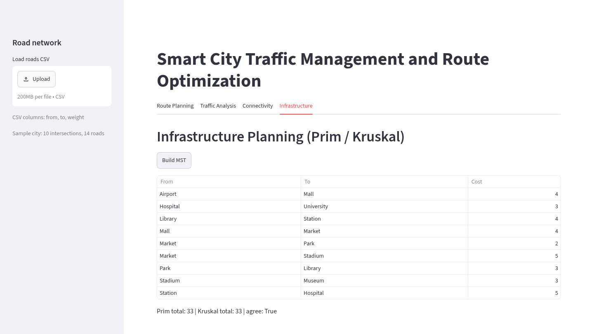

The infrastructure tab shows the MST edge table and both totals, so a
disagreement would be visible immediately.

Run the app:

```bash
streamlit run app.py
```

<div style="page-break-before: always;"></div>

## 4. Experiments

Seeded random connected cities with a spanning tree plus exactly n/2
unique extra roads; duplicate draws are retried until the count is reached.
Timing is the best of 7 runs. Memory is the median peak of 7 separate runs,
measured with tracemalloc outside the timer, so tracing overhead does not
inflate the times.

| Intersections | Roads | BFS (s) | DFS (s) | Dijkstra (s) | Bellman-Ford (s) | Prim (s) | Kruskal (s) |
|---|---|---|---|---|---|---|---|
| 10 | 14 | 0.000002 | 0.000003 | 0.000004 | 0.000017 | 0.000004 | 0.000008 |
| 25 | 36 | 0.000005 | 0.000007 | 0.000012 | 0.000054 | 0.000012 | 0.000020 |
| 50 | 74 | 0.000010 | 0.000014 | 0.000018 | 0.000158 | 0.000026 | 0.000045 |
| 100 | 149 | 0.000020 | 0.000029 | 0.000025 | 0.000318 | 0.000062 | 0.000088 |
| 150 | 224 | 0.000034 | 0.000045 | 0.000046 | 0.000507 | 0.000096 | 0.000150 |
| 200 | 299 | 0.000044 | 0.000063 | 0.000116 | 0.000673 | 0.000134 | 0.000194 |

Peak memory in KB, median of 7 traced runs:

| Intersections | BFS | DFS | Dijkstra | Bellman-Ford | Prim | Kruskal |
|---|---|---|---|---|---|---|
| 10 | 1.77 | 1.02 | 1.35 | 1.55 | 1.10 | 1.66 |
| 25 | 3.77 | 3.27 | 4.55 | 4.79 | 3.24 | 4.65 |
| 50 | 3.83 | 3.40 | 6.40 | 6.82 | 3.49 | 6.44 |
| 100 | 12.53 | 11.99 | 7.84 | 18.19 | 12.18 | 17.41 |
| 150 | 12.41 | 12.12 | 12.15 | 20.42 | 12.71 | 18.23 |
| 200 | 13.17 | 12.40 | 27.43 | 28.76 | 13.21 | 25.77 |

Cross-checks at every size: Prim total equals Kruskal total
(57, 189, 355, 731, 1049, 1442), Dijkstra cost equals Bellman-Ford cost
(13, 24, 27, 21, 26, 49).

Peak memory stays below 30 KB. BFS and DFS end near 13 KB at 200 nodes;
Dijkstra and Bellman-Ford reach 27.4 and 28.8 KB because their distance and
predecessor maps dominate. The small 25 to 50 node BFS step (3.77 to 3.83
KB) is allocator noise; these are median peaks and sub-kilobyte differences
do not survive reruns.

### 4.1 BFS vs DFS

| Size | BFS (s) | DFS (s) | Observation |
|---|---|---|---|
| 10 | 0.000002 | 0.000003 | level order vs depth order, same reach |
| 25 | 0.000005 | 0.000007 | gap about 2 microseconds |
| 50 | 0.000010 | 0.000014 | linear in nodes plus roads |
| 100 | 0.000020 | 0.000029 | DFS about 45 percent slower |
| 150 | 0.000034 | 0.000045 | same gap, more nodes |
| 200 | 0.000044 | 0.000063 | DFS about 43 percent slower |

Both are linear; DFS carries a larger constant because the stack stores
parent pairs and the order reverses neighbour lists.

### 4.2 Dijkstra vs Bellman-Ford

| Size | Dijkstra (s) | Bellman-Ford (s) | Ratio |
|---|---|---|---|
| 10 | 0.000004 | 0.000017 | 4.3x |
| 25 | 0.000012 | 0.000054 | 4.7x |
| 50 | 0.000018 | 0.000158 | 8.7x |
| 100 | 0.000025 | 0.000318 | 12.7x |
| 150 | 0.000046 | 0.000507 | 11.1x |
| 200 | 0.000116 | 0.000673 | 5.8x |

Dijkstra is faster at every size. The ratio peaks at 12.7x at 100 nodes and
falls to 5.8x at 200, where the single seeded graph gives Dijkstra a longer
destination path and more heap work. The observed exponent is the more
stable comparison: 1.11 for Dijkstra and 1.21 for Bellman-Ford.

Bellman-Ford is also far below its V*E bound. From 10 to 200 nodes, V grows
20x and E grows 21.4x, so V*E grows about 428x, but measured time grows
about 40x. The early exit (`if changed == 0: break`) stops after 4 rounds on
these graphs, so the worst case is never reached.

### 4.3 Prim vs Kruskal

| Size | Prim (s) | Kruskal (s) | MST total |
|---|---|---|---|
| 10 | 0.000004 | 0.000008 | 57 |
| 25 | 0.000012 | 0.000020 | 189 |
| 50 | 0.000026 | 0.000045 | 355 |
| 100 | 0.000062 | 0.000088 | 731 |
| 150 | 0.000096 | 0.000150 | 1049 |
| 200 | 0.000134 | 0.000194 | 1442 |

Prim is faster here at every size (1.4x to 2x) because the heap frontier is
smaller than a full sort of all roads. Totals are identical, so either
builder is safe and the pair cross-validates the result.


<div style="page-break-before: always;"></div>

### 4.4 Observed growth

`k = ln(t200 / t10) / ln(E200 / E10)`, with E from 14 to 299 (21.4x).
Ratios use the unrounded CSV values:

| Algorithm | 10 nodes (s) | 200 nodes (s) | Time ratio | Observed k |
|---|---|---|---|---|
| BFS | 0.000002 | 0.000044 | 19.7x | 0.97 |
| DFS | 0.000003 | 0.000063 | 21.9x | 1.01 |
| Dijkstra | 0.000004 | 0.000116 | 30.3x | 1.11 |
| Bellman-Ford | 0.000017 | 0.000673 | 40.4x | 1.21 |
| Prim | 0.000004 | 0.000134 | 30.8x | 1.12 |
| Kruskal | 0.000008 | 0.000194 | 23.1x | 1.03 |

Traversal sits at 0.97 to 1.01, close to linear. Dijkstra and Prim are near
1.1, Kruskal 1.03, and Bellman-Ford 1.21. All are far below the worst-case
exponents because the graphs are sparse and Bellman-Ford exits early.
Microsecond timings still carry noise, so the second decimal is indicative.

<div style="page-break-before: always;"></div>

## 5. Testing

`tests.py` uses `unittest` and checks the contract between modules, not
just that they run:

- Prim and Kruskal return 9 edges and the same total (33).
- Dijkstra and Bellman-Ford return the same cost (13) and path.
- BFS reaches 10/10 and both traversals build 9-edge trees.
- A disconnected node gives an empty path, infinite cost, and a smaller
  reachable set (10/11).
- Union-find merges components and rejects a repeated union.
- Congestion reroutes 13 to 17; an off-route jam leaves the route and cost
  unchanged.
- The adjacency matrix is symmetric, has a zero diagonal, and holds 28
  directed entries.
- The CSV loader rebuilds the 10-node, 14-road city and the cost-13 route.

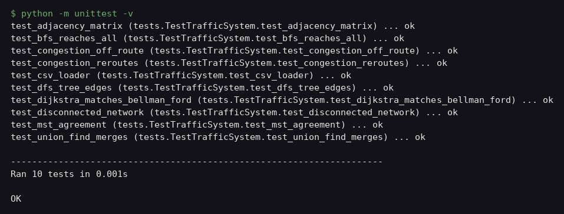

Run them with `python -m unittest -v`. All 10 pass.

<div style="page-break-before: always;"></div>

## 6. Analysis

Dijkstra suits live routing: fastest single-source queries and no negative
weights on roads. Bellman-Ford is used here as an independent cross-check
on every Dijkstra result and would be required if weights could go negative
(for example toll credits). Its round trace shows how many relaxation passes
were needed before distances settled. BFS maps zones level by level for
monitoring; DFS explores deep branches first for accessibility sweeps. Prim
and Kruskal are interchangeable here - run both and require agreement.

Time-space view: traversal is linear in nodes plus roads with tiny memory;
Dijkstra costs a heap; Bellman-Ford costs repeated sweeps; MST builders cost
a heap or a sort plus near-constant union-find. Peak memory stays below 30KB
in every run, reaching 28.8KB at 200 intersections for Bellman-Ford, whose
distance and predecessor maps dominate.

## 7. Limitations

- Weights are static. There is no live traffic feed.
- Roads are undirected; one-way streets are not modeled.
- Scaling uses synthetic random graphs, not measured traffic counts.
- Microsecond timings are noisy; medians reduce but do not remove the
  noise.
- Every run used one machine and one Python version, so absolute times
  will differ elsewhere.

## 8. Conclusion

The system routes the sample city in 13 cost units, reroutes around
simulated jams to 17, reaches all 10 intersections from any start, and
plans infrastructure for 33 units with two agreeing builders. Scaling runs
from 10 to 200 intersections show Dijkstra faster than Bellman-Ford at
every size, near-linear traversal, and Prim/Kruskal parity. Ten unit tests
cover the same contracts. Next steps: one-way roads, live traffic feeds,
and signal-timing optimization.

<div style="page-break-before: always;"></div>

## 9. How to reproduce

```bash
python route_planner.py
python traffic_analysis.py
python connectivity_module.py
python mst_planner.py
python run_scenarios.py
python -m unittest -v
streamlit run app.py
```

Scaling experiments plus figures (run from this folder):

```bash
python run_experiments.py
python make_plots.py
```

Repository:
https://github.com/Vic-41148/algorithm-efficiency-case-study-aditya-shibu-2401201047
