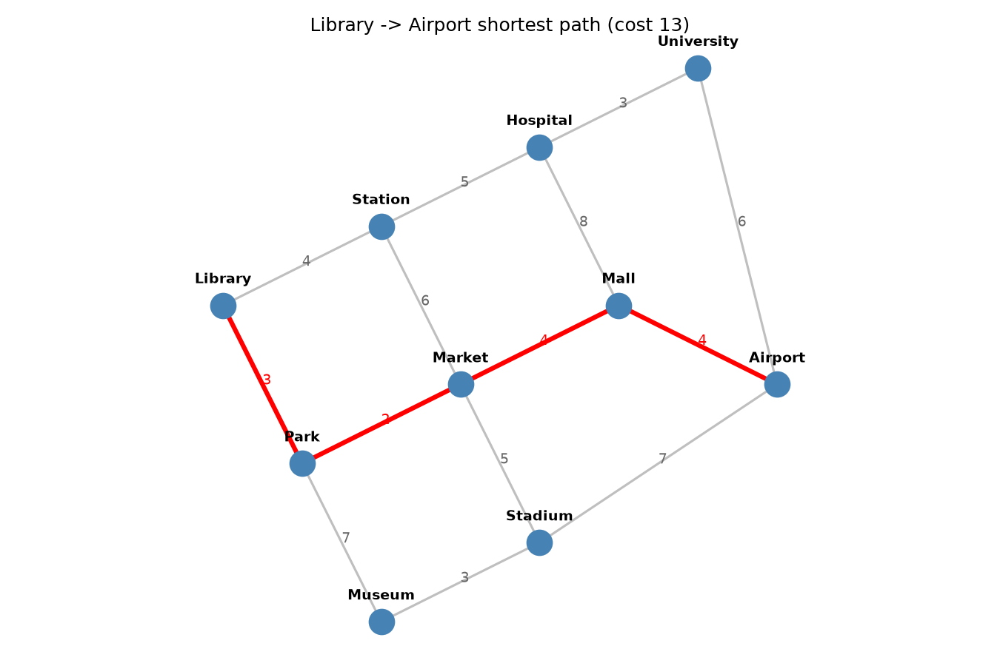
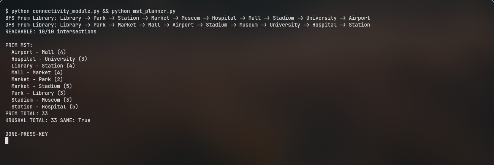
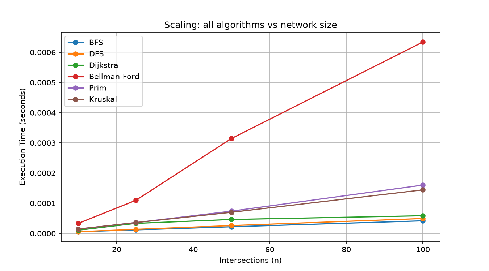

<div style="text-align: center;"></div>

<hr>

<div style="text-align: center;">
<h1>K.R. Mangalam University</h1>
<h3>School of Engineering and Technology</h3>
<h3>SMART CITY TRAFFIC MANAGEMENT AND ROUTE OPTIMIZATION SYSTEM</h3>
<p>Program: BCA (AI & DS)<br>Course Code - ENCA351 (2026-27)</p>
</div>

<table class="front">
<tr>
<td><strong>Submitted by:</strong><br>Name: Aditya Shibu<br>Roll Number: 2401201047<br>Course: BCA (AI & DS) - Section B</td>
<td style="text-align: right;"><strong>Submitted To:</strong><br>Dr. Aarti Sangwan<br>Faculty, SOET</td>
</tr>
</table>

<div style="page-break-before: always;"></div>

<style>pre { font-size: 10px; } table { font-size: 12.5px; break-inside: avoid; } th, td { padding: 5px 10px; } table.front, table.front td { border: none; }</style>

## 1. Introduction

Smart city initiatives use intelligent algorithms to run transportation:
road networks are modeled as graphs, shortest-path algorithms route
commuters, traversal maps reachable zones, and spanning trees plan the
cheapest infrastructure that keeps every intersection connected.

Traffic optimization matters because congestion wastes time and fuel,
delays emergency response, and underuses existing roads. A system that
recomputes routes when roads jam, and that plans new links for minimum
cost, turns the road network from a static map into a managed resource.

This project builds such a system: a 10-intersection sample city plus
four modules (route planning with Dijkstra, congestion analysis with
Bellman-Ford, BFS/DFS connectivity, Prim/Kruskal MST), scaling runs on
10 to 100 intersections, and an interactive Streamlit app.

<div style="page-break-before: always;"></div>

## 2. Modules

### 2.1 Road network modeling

Intersections are vertices, roads are weighted undirected edges (travel
cost). The model exposes both representations:

route_planner.py (RoadNetwork model):

```python
class RoadNetwork:
    """Undirected weighted graph. Nodes = intersections, edges = roads."""

    def __init__(self):
        self.adj = {}   # node -> {neighbor: weight}

    def add_intersection(self, name):
        self.adj.setdefault(name, {})

    def add_road(self, u, v, w, two_way=True):
        self.add_intersection(u)
        self.add_intersection(v)
        self.adj[u][v] = w
        if two_way:
            self.adj[v][u] = w

    def nodes(self):
        return sorted(self.adj)

    def roads(self):
        seen, out = set(), []
        for u, nbrs in self.adj.items():
            for v, w in nbrs.items():
                if (v, u) not in seen:
                    seen.add((u, v))
                    out.append((u, v, w))
        return sorted(out)

    def adjacency_list(self):
        return {u: sorted(nbrs.items()) for u, nbrs in sorted(self.adj.items())}

    def adjacency_matrix(self):
        nodes = self.nodes()
        idx = {n: i for i, n in enumerate(nodes)}
        n = len(nodes)
        mat = [[0] * n for _ in range(n)]
        for u, v, w in self.roads():
            mat[idx[u]][idx[v]] = w
            mat[idx[v]][idx[u]] = w
        return nodes, mat
```

```text
Library: [('Park', 3), ('Station', 4)]
Market: [('Mall', 4), ('Park', 2), ('Stadium', 5), ('Station', 6)]
```



### 2.2 Route planning (Dijkstra)

A commuter enters source and destination; the system settles intersections
in order of current-best distance and returns the shortest route, its cost,
and the settle trace.

route_planner.py (Dijkstra):

```python
def dijkstra(network, source, dest):
    """Shortest path. Returns (path, cost, trace) where trace lists
    each settled node with its final distance, in settle order."""
    dist = {n: float("inf") for n in network.nodes()}
    prev = {}
    dist[source] = 0
    pq, visited, trace = [(0, source)], set(), []
    while pq:
        d, u = heapq.heappop(pq)
        if u in visited:
            continue
        visited.add(u)
        trace.append((u, d))
        if u == dest:
            break
        for v, w in network.adj[u].items():
            nd = d + w
            if nd < dist[v]:
                dist[v] = nd
                prev[v] = u
                heapq.heappush(pq, (nd, v))
    if dist[dest] == float("inf"):
        return [], float("inf"), trace
    path, cur = [], dest
    while cur != source:
        path.append(cur)
        cur = prev[cur]
    path.append(source)
    return path[::-1], dist[dest], trace
```

Library to Airport settles
Library(0), Park(3), Station(4), Market(5), Hospital(9), Mall(9),
Museum(10), Stadium(10), University(12), Airport(13) and returns
Library -> Park -> Market -> Mall -> Airport, cost 13 (3+2+4+4).


### 2.3 Traffic analysis (Bellman-Ford plus congestion)

Administrators scale selected road weights to simulate jams, then
recompute. Bellman-Ford relaxes every road each round and reports
per-round relaxation counts plus negative-cycle status.

traffic_analysis.py (Bellman-Ford):

```python
def bellman_ford(network, source):
    """Shortest paths from source. Returns (dist, prev, trace, ok) where
    trace records every relaxation round and ok=False on negative cycle."""
    nodes = network.nodes()
    dist = {n: float("inf") for n in nodes}
    prev = {}
    dist[source] = 0
    trace = []
    for i in range(len(nodes) - 1):
        changed = 0
        for u, v, w in network.roads():
            for a, b in ((u, v), (v, u)):
                if dist[a] + w < dist[b]:
                    dist[b] = dist[a] + w
                    prev[b] = a
                    changed += 1
        trace.append((i + 1, changed))
        if changed == 0:
            break
    ok = True
    for u, v, w in network.roads():
        for a, b in ((u, v), (v, u)):
            if dist[a] + w < dist[b]:
                ok = False
    return dist, prev, trace, ok
```

Jamming Market-Mall and Mall-Airport by x3 moves the Airport route to
Library -> Park -> Market -> Stadium -> Airport, cost 13 -> 17
(delta +4, rerouted). Round trace: (1, 5), (2, 6), (3, 1), (4, 0).

traffic_analysis.py (congestion compare):

```python
def apply_congestion(network, congested_edges, factor):
    """Copy of network with listed roads scaled by factor. Returns new network."""
    from route_planner import RoadNetwork
    busy = RoadNetwork()
    congested = {tuple(sorted(e)) for e in congested_edges}
    for u, v, w in network.roads():
        busy.add_road(u, v, w * factor if tuple(sorted((u, v))) in congested else w)
    return busy


def compare_routes(network, source, dest, congested_edges, factor):
    """Original vs congested shortest routes. Returns dict with both."""
    p0, c0, _ = dijkstra(network, source, dest)
    busy = apply_congestion(network, congested_edges, factor)
    p1, c1, _ = dijkstra(busy, source, dest)
    return {"original": (p0, c0), "congested": (p1, c1),
            "delta": c1 - c0, "rerouted": p0 != p1}
```


### 2.4 Connectivity (BFS plus DFS)

From any start intersection the system lists traversal order and the
reachable set (10/10 on the sample city - one connected component).

BFS from Library:
Library -> Park -> Station -> Market -> Museum -> Hospital -> Mall ->
Stadium -> University -> Airport.
DFS from Library:
Library -> Park -> Market -> Mall -> Airport -> Stadium -> Museum ->
University -> Hospital -> Station.



connectivity_module.py (complete file):

```python
def bfs(network, start):
    """Breadth-first order from start. Returns (order, reachable)."""
    order, seen = [], {start}
    queue = deque([start])
    while queue:
        u = queue.popleft()
        order.append(u)
        for v in sorted(network.adj[u]):
            if v not in seen:
                seen.add(v)
                queue.append(v)
    return order, seen


def dfs(network, start):
    """Depth-first order from start (iterative). Returns (order, reachable)."""
    order, seen, stack = [], set(), [start]
    while stack:
        u = stack.pop()
        if u in seen:
            continue
        seen.add(u)
        order.append(u)
        for v in sorted(network.adj[u], reverse=True):
            if v not in seen:
                stack.append(v)
    return order, seen
```

### 2.5 Infrastructure planning (Prim plus Kruskal)

Both MST builders run on the same network and must agree; on the sample
city both select 9 roads totaling 33.

mst_planner.py (UnionFind plus builders):

```python
class UnionFind:
    def __init__(self, nodes):
        self.parent = {n: n for n in nodes}
        self.rank = {n: 0 for n in nodes}

    def find(self, x):
        while self.parent[x] != x:
            self.parent[x] = self.parent[self.parent[x]]
            x = self.parent[x]
        return x

    def union(self, a, b):
        ra, rb = self.find(a), self.find(b)
        if ra == rb:
            return False
        if self.rank[ra] < self.rank[rb]:
            ra, rb = rb, ra
        self.parent[rb] = ra
        if self.rank[ra] == self.rank[rb]:
            self.rank[ra] += 1
        return True
```

```python
def prim(network, start=None):
    """Grow MST from cheapest frontier edge. Returns (edges, total)."""
    import heapq
    nodes = network.nodes()
    start = start or nodes[0]
    visited, edges, total = {start}, [], 0
    pq = [(w, start, v) for v, w in network.adj[start].items()]
    heapq.heapify(pq)
    while pq and len(visited) < len(nodes):
        w, u, v = heapq.heappop(pq)
        if v in visited:
            continue
        visited.add(v)
        edges.append((u, v, w))
        total += w
        for to, w2 in network.adj[v].items():
            if to not in visited:
                heapq.heappush(pq, (w2, v, to))
    return sorted(edges), total


def kruskal(network):
    """Sort all roads, take cheapest that connects components."""
    uf = UnionFind(network.nodes())
    edges, total = [], 0
    for u, v, w in sorted(network.roads(), key=lambda e: e[2]):
        if uf.union(u, v):
            edges.append((u, v, w))
            total += w
    return sorted(edges), total
```


## 3. Experiments

Seeded random connected cities (spanning tree plus n/2 extra roads),
best of 5 runs, time plus peak memory.

| Intersections | Roads | BFS (s) | DFS (s) | Dijkstra (s) | Bellman-Ford (s) | Prim (s) | Kruskal (s) |
|---|---|---|---|---|---|---|---|
| 10 | 11 | 0.000005 | 0.000006 | 0.000012 | 0.000035 | 0.000015 | 0.000015 |
| 25 | 36 | 0.000011 | 0.000013 | 0.000033 | 0.000113 | 0.000036 | 0.000036 |
| 50 | 72 | 0.000020 | 0.000024 | 0.000045 | 0.000307 | 0.000073 | 0.000069 |
| 100 | 148 | 0.000041 | 0.000047 | 0.000058 | 0.000626 | 0.000155 | 0.000141 |

Cross-checks at every size: Prim total equals Kruskal total
(61, 189, 362, 731), Dijkstra cost equals Bellman-Ford cost
(13, 24, 27, 21).

### 3.1 BFS vs DFS

| Size | BFS (s) | DFS (s) | Observation |
|---|---|---|---|
| 10 | 0.000005 | 0.000006 | level order vs depth order, same reach |
| 25 | 0.000011 | 0.000013 | gap under 2 microseconds |
| 50 | 0.000020 | 0.000024 | linear in nodes plus roads |
| 100 | 0.000041 | 0.000047 | DFS ~15 percent slower (stack churn) |

### 3.2 Dijkstra vs Bellman-Ford

| Size | Dijkstra (s) | Bellman-Ford (s) | Ratio |
|---|---|---|---|
| 10 | 0.000012 | 0.000035 | 2.9x |
| 25 | 0.000033 | 0.000113 | 3.4x |
| 50 | 0.000045 | 0.000307 | 6.8x |
| 100 | 0.000058 | 0.000626 | 10.8x |

Heap selection beats full relaxation sweeps, and the gap widens with
size. Costs agree everywhere, so Bellman-Ford doubles as the congestion
checker while Dijkstra answers live queries.

### 3.3 Prim vs Kruskal

| Size | Prim (s) | Kruskal (s) | MST total |
|---|---|---|---|
| 10 | 0.000015 | 0.000015 | 61 |
| 25 | 0.000036 | 0.000036 | 189 |
| 50 | 0.000073 | 0.000069 | 362 |
| 100 | 0.000155 | 0.000141 | 731 |

Effectively tied; edge totals identical, so either builder is safe and
the pair cross-validates the result.



## 4. Analysis

Dijkstra suits live routing (fastest single-source queries, no negative
weights on roads). Bellman-Ford suits congestion analysis (tolerates
weight edits, flags negative cycles, and its round trace shows how far
each jam propagates). BFS maps zones level by level for monitoring;
DFS explores deep branches first for accessibility sweeps. Prim and
Kruskal are interchangeable here - run both and require agreement.

Time-space view: traversal is linear in nodes plus roads with tiny
memory; Dijkstra costs a heap; Bellman-Ford costs repeated sweeps;
MST builders cost a heap or a sort plus near-constant union-find.
Nothing in the measured range exceeds 19KB peak.

## 5. Conclusion

The system routes the sample city in 13 cost units, reroutes around
simulated jams with a measured delta, reaches all 10 intersections from
any start, and plans infrastructure for 33 units with two agreeing
builders. Scaling runs confirm Dijkstra over Bellman-Ford for queries
(~11x at 100 nodes) and Prim/Kruskal parity throughout. Next steps:
one-way roads, live traffic feeds, and signal-timing optimization.

## 6. How to reproduce

```bash
python route_planner.py
python traffic_analysis.py
python connectivity_module.py
python mst_planner.py
```

Scaling experiments plus figures (run from this folder):

```bash
python run_experiments.py
python make_plots.py
```
